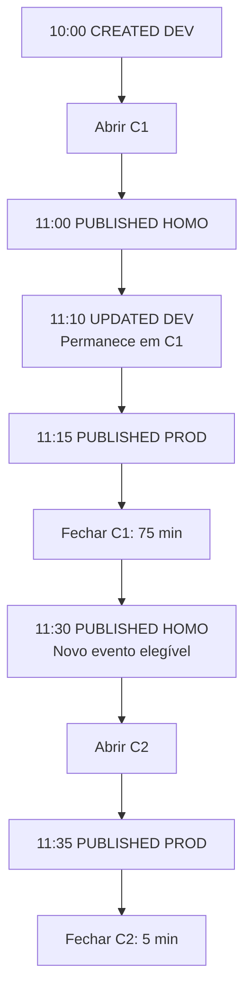
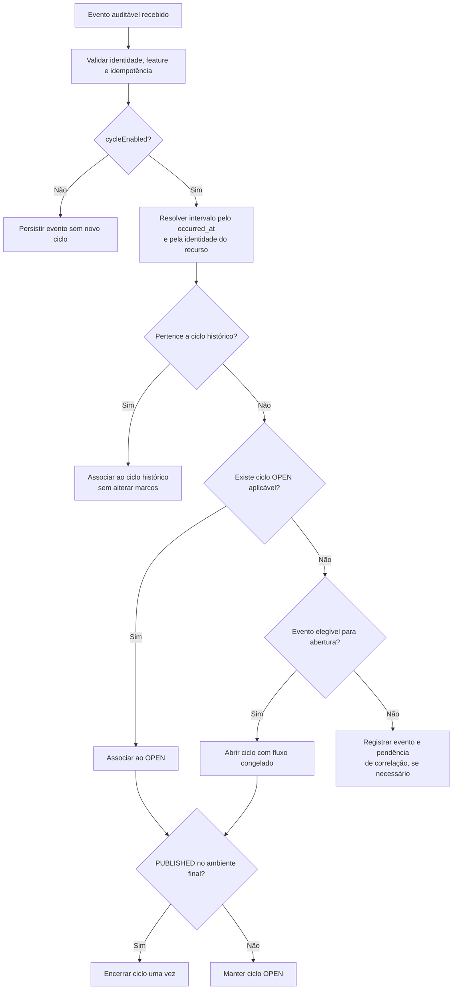
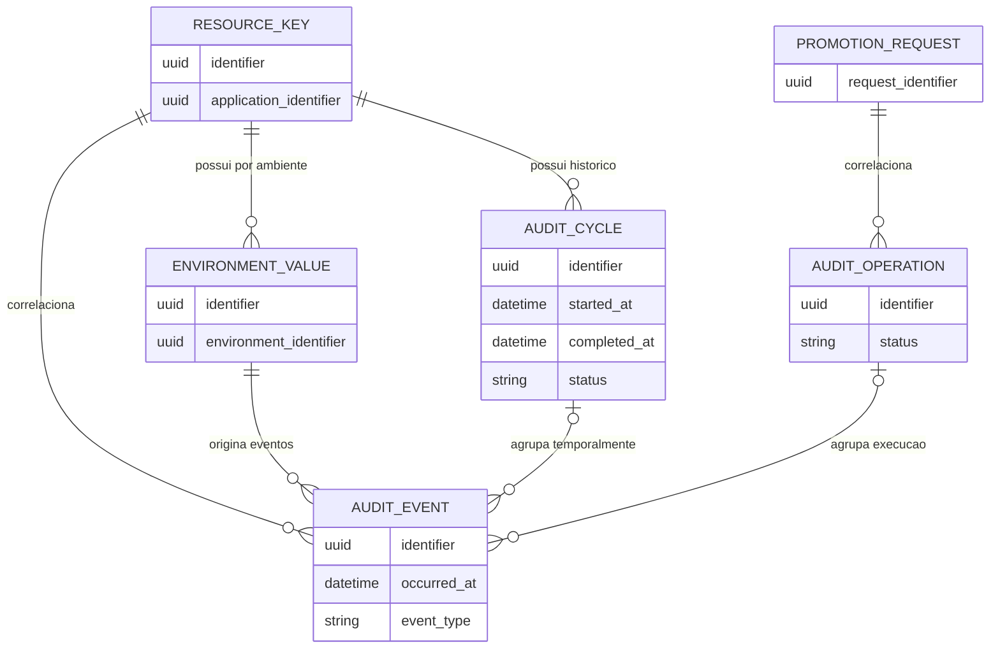
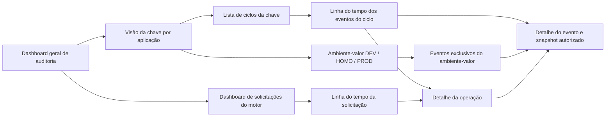
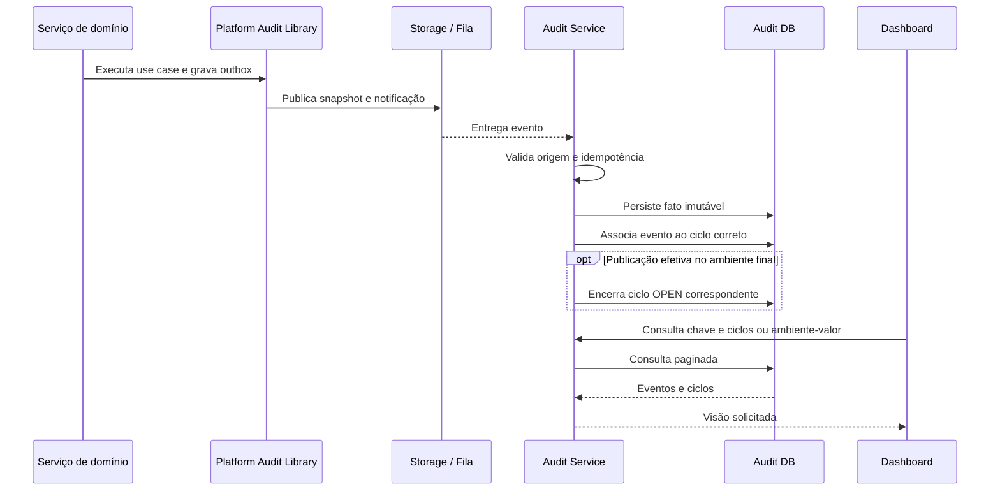

# Audit Cycle — Refinamento funcional V5 (proposta para discussão)

> Data: 30/10/2026. Escopo: evolução de ciclos por recurso e visões de auditoria.  
> Referência: `docs/refinamento/05-auditoria/audit-service_V4.md`.  
> **Precedência proposta:** este documento revisa especificamente a regra da seção 10 da V4, que limitava o recurso a um único ciclo por toda a vida. A nova regra permite **vários ciclos históricos e no máximo um ciclo OPEN por recurso**. Os demais contratos da V4 permanecem como referência até revisão explícita. **Não considerar esta proposta como implementação existente.**

## 1. Objetivo

Permitir que um recurso auditável tenha sucessivas jornadas de evolução, cada uma iniciada por um evento elegível e encerrada pela publicação no ambiente final configurado. Um ciclo reúne os eventos da mesma entidade lógica independentemente do ambiente, pacote, operação e fluxo de promoção.

O ciclo **não** é a unidade de medição do tempo de uma solicitação do motor. Esse indicador será derivado dos eventos próprios do motor, correlacionados pelo identificador da solicitação, com projeção analítica independente.

## 2. Conceitos e fronteiras

- **Audit Event:** fato imutável, com identidade da origem, feature, recurso, ambiente, horário de ocorrência, correlação e vínculos opcionais com operação/ciclo/snapshot.
- **Audit Operation:** execução agrupadora de eventos de múltiplos recursos, features e aplicações. Uma promoção DEV → HOMO e outra HOMO → PROD são operações distintas, ainda que pertençam à mesma solicitação.
- **Audit Cycle:** intervalo de evolução de **um recurso lógico**, não de uma versão, pacote, operação ou ambiente-valor.
- **Solicitação do motor:** jornada transversal que pode conter múltiplos pacotes e operações; seus indicadores não dependem de Audit Cycle.
- **Ambiente-valor:** entidade dependente da chave em um ambiente específico. Seu histórico é apresentado como eventos, sem ciclo próprio.

A identidade lógica do recurso segue a V4: conta + microserviço + feature + identificador estável do recurso. Preservar aplicação e contexto pertinentes para isolamento, mas não substituir a identidade da entidade principal pela do valor de ambiente.

## 3. Regras funcionais de ciclo

**RC-01 — Habilitação.** Criar/associar ciclos somente para feature com `settings.audit.cycleEnabled=true`, conforme resolução da view do Workspace prevista na V4. A ausência da flag equivale a false. Eventos continuam auditáveis sem ciclo.

**RC-02 — Multiplicidade.** Um recurso pode ter vários ciclos COMPLETED ao longo de sua existência, mas **no máximo um OPEN**. Ciclos históricos não podem se sobrepor no tempo para a mesma identidade lógica.

**RC-03 — Abertura inicial.** O primeiro `CREATED` elegível no ambiente inicial abre o primeiro ciclo. A criação e a publicação no mesmo ambiente são fatos distintos, quando assim emitidos pelo produtor.

**RC-04 — Abertura subsequente.** Após o encerramento de um ciclo, o próximo evento elegível de evolução abre novo ciclo. Para o cenário de promoção discutido, `PROMOTED`/`PUBLISHED` no ambiente intermediário pode iniciar novo ciclo quando não houver ciclo OPEN. A lista exata de eventos de abertura, incluindo `UPDATED` em DEV após um encerramento, deverá ser fechada contra os tipos realmente emitidos pela biblioteca/motor. Não inferir abertura a partir de evento técnico genérico.

**RC-05 — Associação.** Com ciclo OPEN, todos os eventos elegíveis da mesma entidade principal pertencem ao ciclo, mesmo que ocorram em outros ambientes, pacotes, solicitações ou operações. Alterações em DEV durante o fluxo **não** abrem ciclo paralelo e **não** reiniciam `started_at`.

**RC-06 — Fechamento.** O ciclo é encerrado somente pelo evento de **publicação efetiva `PUBLISHED` no ambiente final** congelado no ciclo, não por `PROMOTED` isolado, sucesso da operação ou conclusão da solicitação. Se o motor promover e publicar em uma mesma execução, a auditoria deve reconhecer o fato de publicação efetiva, sem inventar evento que o produtor não emite. O fechamento é por recurso: sucesso parcial da operação fecha apenas os ciclos dos recursos efetivamente publicados.

**RC-07 — Tempo.** `duration = completed_at - started_at`, utilizando timestamps do fato (`occurred_at`), e não horário de ingestão. É o tempo da **jornada entre a abertura do ciclo e a próxima publicação final**, não o lead time de cada alteração individual nem a duração de execução do motor.

**RC-08 — Fluxo congelado.** Na abertura, consultar `VW_AUDIT_ACCOUNT_ENVIRONMENT_FLOW` e congelar ambientes inicial/final e referência do fluxo aplicável. Alterações posteriores na configuração não reescrevem ciclos existentes.

**RC-09 — Imutabilidade.** Ciclo COMPLETED não reabre, não altera `started_at`/`completed_at` nem muda de status. Eventos tardios podem ser associados historicamente ao intervalo correto sem alterar esses marcos, respeitando política de aceitação de atraso vigente.

**RC-10 — Identidade e idempotência.** Eventos duplicados não abrem ciclos, não duplicam associações e não encerram duas vezes. Proteger a unicidade de ciclo OPEN por identidade lógica com constraint/índice ou mecanismo transacional equivalente adequado ao MySQL.

**RC-11 — Evento fora de ordem.** O consumidor não deve associar cegamente ao ciclo OPEN atual. Resolver pela identidade, `occurred_at`, fronteiras de ciclos e correlação de negócio. Um evento ocorrido antes de um fechamento, mas recebido depois, pode pertencer ao ciclo histórico. Eventos sem contexto suficiente devem ser diagnosticados e reconciliados, não vinculados por aproximação.

**RC-12 — Ausência de origem.** Se faltar o evento que justificaria a abertura, não inventar timestamp de criação. Registrar pendência de correlação e aplicar a política de reconciliação explicitamente aprovada.

**RC-13 — Mudança da flag.** Desabilitar `cycleEnabled` não apaga histórico nem reescreve ciclos. A política para fechar um ciclo já OPEN após desabilitação e para reabilitação posterior exige definição explícita antes da implementação; não adotar encerramento automático.

## 4. Jornada de referência

Recurso: chave `payment.timeout` da aplicação. Os valores são entidades distintas em DEV, HOMO e PROD.

| Horário | Fato | Operação | Ciclo |
| --- | --- | --- | --- |
| 10h00 | Chave/valor criado em DEV | — | Abre C1 |
| 11h00 | Promovido e publicado em HOMO | O100 | C1 continua OPEN |
| 11h10 | Valor alterado em DEV | — | C1 continua OPEN |
| 11h15 | Promovido e publicado em PROD, usando o valor já presente em HOMO | O200 | Fecha C1 (75 min) |
| 11h30 | Novo pacote publica a alteração pendente em HOMO | O300 | Abre C2 |
| 11h35 | Publica em PROD | O400 | Fecha C2 (5 min) |

**Interpretação intencional:** a alteração das 11h10 faz parte do histórico de C1, embora seu conteúdo só chegue a PROD em C2. Portanto, o tempo de C2 **não mede** o tempo decorrido desde a alteração das 11h10. O modelo mede jornadas do recurso, não entrega por revisão. Caso seja exigida rastreabilidade de revisões, será uma capacidade adicional, sem alterar silenciosamente o significado de ciclo.

## 5. Duas visões de auditoria

### 5.1 Visão da entidade principal — chave por aplicação

Entrada: identidade estável da chave no contexto da aplicação. Exibir ciclos históricos e OPEN, `started_at`, `completed_at`, duração, ambiente final, evento de encerramento e linha do tempo dos eventos associados. Permitir navegar do evento para operação, ambiente e snapshot quando existentes. Paginar ciclos e eventos.

### 5.2 Visão da entidade ambiente-valor

Entrada: identidade estável do registro de valor em um ambiente. Exibir **somente os eventos dessa entidade e desse ambiente**, cronologicamente, sem criar ciclo próprio. Um evento do ambiente-valor precisa permitir correlacionar sua **chave principal** para integrar a visão do ciclo; a correlação deve vir do contrato de evento/metadados confiáveis, sem exigir leitura transacional do serviço de origem a cada consulta.

**Não duplicar eventos** entre as visões. São projeções/consultas diferentes sobre fatos persistidos.

## 6. Operações e motor de promoção

Uma operação pode agrupar eventos de muitas features e aplicações. Um ciclo pode conter eventos de várias operações; uma operação pode participar de muitos ciclos. O vínculo é feito por `AUDIT_EVENT.operation_id?` e `AUDIT_EVENT.cycle_id?`, sem exigir relação direta operação↔ciclo.

Para o motor, a solicitação é a unidade do lead time: início no evento de criação da solicitação e término no evento explícito de conclusão do fluxo, identificados por uma chave estável de solicitação. A duração não depende da quantidade de recursos, features, aplicações ou operações.

Projeção analítica recomendada, reconstruível a partir dos eventos do motor: identificador da solicitação, status, início/fim, duração, quantidades distintas de operações, features, aplicações e recursos. Atualização incremental com reconciliação periódica de inconsistências. **Não criar Audit Cycle por solicitação.** Os nomes concretos dos eventos do motor e o contrato de correlação devem ser confirmados antes da implementação.

## 7. Consistência assíncrona e concorrência

- Persistir evento de forma idempotente antes de consolidar a associação com o ciclo.
- Conciliar recebimentos fora de ordem por `occurred_at` e correlação, inclusive após o encerramento.
- Manter datas/status de ciclo encerrado imutáveis; vinculação histórica tardia não pode alterar duração.
- Aplicar a política de tolerância de atraso de eventos já definida para o serviço (48 horas, se confirmada no contrato operacional vigente), **não** como duração máxima do ciclo nem limite de busca do scheduler.
- Reconciliar ciclos OPEN independentemente de sua idade; uma jornada pode durar dias ou meses.
- Impedir dois ciclos OPEN para o mesmo recurso sob ingestão concorrente.
- Testar fronteiras exatas de timestamp (evento no mesmo instante do fechamento), deduplicação e publicação concorrente.

## 8. Modelo lógico e impactos na V4

Preservar `AUDIT_EVENT`, `AUDIT_OPERATION`, `AUDIT_CYCLE`, `AUDIT_SNAPSHOT` e os catálogos oficiais da V4. **Não criar** `AUDIT_RESOURCE_TYPE` ou `AUDIT_SERVICE_TYPE` administrativos locais.

Mudanças necessárias em relação à V4:
1. Remover a unicidade vitalícia de `AUDIT_CYCLE` por recurso; substituí-la pela garantia de no máximo um ciclo OPEN.
2. Permitir múltiplos ciclos históricos da mesma identidade lógica.
3. Definir e testar a seleção temporal do ciclo de cada evento.
4. Persistir/derivar referência ao evento de fechamento para auditoria da causa do encerramento; validar nomenclatura física antes de migrations.
5. Assegurar vínculo confiável dos eventos de ambiente-valor à identidade da chave principal.
6. Separar consultas por chave (ciclos + eventos) e por ambiente-valor (eventos).

Nenhum nome novo de coluna, endpoint, pacote ou assinatura Java é normativo neste refinamento; confrontar com código, migrations, views e contratos existentes antes de codificar.

## 9. Critérios de aceite

- CA01: primeiro evento de abertura elegível cria C1; duplicata não cria outro.
- CA02: promoção/publicação em HOMO e alteração posterior em DEV permanecem em C1.
- CA03: publicação efetiva no ambiente final fecha C1; `PROMOTED` isolado não fecha.
- CA04: próximo evento elegível após C1 cria C2, preservando C1.
- CA05: recurso participa de pacotes/operações distintos sem perder correlação de ciclo.
- CA06: dois recursos da mesma operação podem encerrar ciclos em operações/dias diferentes.
- CA07: a chave mostra seus ciclos e respectivos eventos; ambiente-valor mostra apenas seus eventos.
- CA08: chegada tardia de evento anterior ao fechamento não reabre nem altera C1.
- CA09: ingestão concorrente não gera dois ciclos OPEN.
- CA10: métricas da solicitação do motor são calculadas sem consultar ciclos dos recursos.
- CA11: desabilitação de feature não apaga trilhas históricas.
- CA12: `clean verify`, testes de integração com MySQL/Testcontainers e regras ArchUnit seguem os padrões Golden, sem declarar sucesso sem execução real.

## 10. Pendências explícitas antes de implementar

1. Fechar a lista de eventos elegíveis para abrir ciclos posteriores (`UPDATED`, `PUBLISHED` intermediário etc.) conforme fatos realmente emitidos.
2. Confirmar como o motor distingue `PROMOTED` de publicação efetiva e qual evento identifica o ambiente de destino.
3. Validar contrato de identidade pai (chave) nos eventos da entidade ambiente-valor.
4. Confirmar comportamento de ciclos OPEN quando `cycleEnabled` muda para false.
5. Validar a política de eventos atrasados, bordas temporais e associação retroativa com a documentação operacional vigente.
6. Confirmar se a V4 será atualizada integralmente após aprovação deste refinamento; até lá, este documento explicita a divergência e não a oculta.

## 11. Limites da entrega

Este arquivo é **refinamento funcional e arquitetural**, não solicitação de implementação. Não altera código, banco, migrations, branches, PRs ou regras de governança além de registrar a proposta para discussão.


---

## 12. Catálogo de cenários funcionais — exemplos ilustrativos

> Os horários, IDs, recursos e números abaixo são **dados fictícios para validar a experiência do usuário**. Não são registros reais. Os exemplos assumem que os eventos de abertura subsequente e a correlação de publicação foram aprovados conforme as pendências da seção 10.

### E01 — Primeira jornada de uma chave, com alteração no meio

**Contexto:** aplicação `PAYMENTS`, chave `payment.timeout`, fluxo DEV → HOMO → PROD.

| Horário | Evento | Ambiente | Operação | Ciclo | Resultado |
| --- | --- | --- | --- | --- | --- |
| 10:00 | CREATED | DEV | — | C-001 | Abre |
| 10:30 | PUBLISHED | DEV | — | C-001 | Continua |
| 11:00 | PROMOTED + PUBLISHED | HOMO | OP-001 | C-001 | Continua |
| 11:10 | UPDATED | DEV | — | C-001 | Continua |
| 11:15 | PROMOTED + PUBLISHED | PROD | OP-002 | C-001 | Fecha |

**Lead time C-001: 75 minutos.** A alteração das 11:10 está no ciclo, mesmo que a versão publicada em PROD seja a versão que já estava em HOMO. Não afirmar que essa alteração foi entregue em PROD.

### E02 — Segundo ciclo do mesmo recurso, em outro pacote

| Horário | Evento | Ambiente | Pacote | Ciclo |
| --- | --- | --- | --- | --- |
| 11:30 | PUBLISHED | HOMO | PKG-002 | Abre C-002 |
| 11:35 | PUBLISHED | PROD | PKG-003 | Fecha C-002 |

**Lead time C-002: 5 minutos.** C-001 continua íntegro. A origem da alteração publicada pode ser anterior ao início de C-002; o ciclo não é uma métrica por revisão.

### E03 — Operação com quatro recursos de duas features

**Pacote PKG-010:** duas chaves `KEY-A`, `KEY-B` e dois menus `MENU-A`, `MENU-B`.

| Recurso | Feature | Ciclo | DEV → HOMO (OP-010) | HOMO → PROD (OP-011) | Tempo do ciclo |
| --- | --- | --- | --- | --- | --- |
| KEY-A | KEY | C-101 | 09:30 | 11:00 | 120 min (abriu 09:00) |
| KEY-B | KEY | C-102 | 09:30 | 11:00 | 90 min (abriu 09:30) |
| MENU-A | MENU | C-103 | 09:30 | 11:00 | 180 min (abriu 08:00) |
| MENU-B | MENU | C-104 | 10:30 | 11:00 | 60 min (abriu 10:00) |

**Regra de validação:** a publicação de MENU-B em HOMO ocorre às 10:30, após sua abertura às 10:00. O dashboard não pode associar ao ciclo eventos anteriores a `started_at`.

**Agregados demonstrativos:** 4 recursos distintos, 2 features distintas, 2 operações, 4 ciclos. Média dos quatro tempos de ciclo = **112,5 minutos**. Essa média é por ciclo, **não** o lead time da solicitação do motor.

### E04 — Recurso promovido em solicitações diferentes

| Horário | Solicitação | Operação | Evento | Ciclo |
| --- | --- | --- | --- | --- |
| Seg 09:00 | — | — | KEY-X CREATED DEV | C-201 abre |
| Seg 12:00 | SOL-A | OP-A | KEY-X PUBLISHED HOMO | C-201 |
| Qua 16:00 | SOL-B | OP-B | KEY-X PUBLISHED PROD | C-201 fecha |

**C-201 dura 55 horas.** O ciclo não é segmentado por solicitação. SOL-A e SOL-B têm lead times próprios, calculados por eventos do motor, não pelo C-201.

### E05 — Falha parcial de uma operação

OP-030 tenta publicar KEY-A, KEY-B e MENU-A em PROD. KEY-A e MENU-A emitem `PUBLISHED PROD`; KEY-B emite `PUBLISH_FAILED`.

Resultado: ciclos de KEY-A e MENU-A encerram; ciclo de KEY-B permanece OPEN. A operação pode ser FAILED conforme a V4, sem forçar fechamento de todos os ciclos.

### E06 — Eventos recebidos fora de ordem

| Ocorrido em | Recebido em | Fato | Associação correta |
| --- | --- | --- | --- |
| 10:00 | 10:01 | CREATED DEV | Abre C-301 |
| 10:20 | 10:40 | UPDATED DEV | C-301 |
| 10:30 | 10:31 | PUBLISHED PROD | Fecha C-301 |

A ingestão do `UPDATED` acontece depois do fechamento, mas o evento pertence temporalmente ao C-301. **Duração: 30 minutos**, sem reabrir ou alterar os marcos.

### E07 — Ciclo OPEN por vários dias

KEY-Y criado segunda às 08:00, publicado em HOMO terça às 09:00 e ainda não publicado em PROD na sexta. C-401 continua OPEN. O dashboard pode exibir **idade atual** (agora − `started_at`) separada da duração final, que permanece nula. Não aplicar timeout de operação nem janela de atraso como expiração automática do ciclo.

### E08 — Mesmo nome de chave em aplicações diferentes

`payment.timeout` em `PAYMENTS` e em `CHECKOUT` são recursos distintos, com identificadores estáveis distintos. Seus ciclos não podem ser misturados. Filtros por aplicação precisam preservar o isolamento por conta e a identidade principal.

### E09 — Publicação sem ciclo habilitado

Feature com `cycleEnabled=false`: `CREATED`, `UPDATED` e `PUBLISHED` continuam registrados e consultáveis; nenhum CYCLE é criado. A visão de histórico do ambiente-valor continua disponível.

### E10 — Uma solicitação com múltiplos pacotes, aplicações e features

SOL-900 criada às 08:00, inclui 2 pacotes, 3 aplicações, 4 features e 12 recursos. OP-901 promove DEV → HOMO às 09:00; OP-902 promove HOMO → PROD às 10:30; evento de conclusão da solicitação às 10:40.

**Lead time da solicitação: 160 minutos.** Independentemente dos 12 ciclos de recursos, o dashboard de solicitações contabiliza SOL-900 **uma única vez**. Quantidades devem usar identificadores distintos, não número de eventos.

## 13. Protótipos textuais de dashboards e navegação

Os protótipos a seguir descrevem **visões de produto**, não APIs existentes. Cada tela deve suportar paginação, filtros, controle de acesso e links para os detalhes correlatos.

### Dashboard A — Visão geral de ciclos de recursos

```text
AUDITORIA / CICLOS                         Período: [últimos 30 dias]
Filtros: [Workspace] [Aplicação] [Feature] [Status] [Ambiente]

Ciclos iniciados:  120     Concluídos no período: 95
Ciclos abertos:     25     Lead time médio concluídos: 2h15
P90 concluídos:    5h10   Mais antigo OPEN: 4 dias

Evolução: [gráfico de ciclos iniciados x concluídos por dia]
Distribuição: [gráfico de duração por faixa]
Detalhamento:
Ciclo    Recurso            Feature  Início        Fim          Duração Status
C-001    payment.timeout    KEY      30/10 10:00   30/10 11:15  75 min  COMPLETED
C-002    payment.timeout    KEY      30/10 11:30   30/10 11:35   5 min  COMPLETED
C-401    KEY-Y              KEY      26/10 08:00   —            —       OPEN
```

**Regras de métricas:** a média e P90 consideram apenas ciclos COMPLETED; ciclos OPEN entram em idade atual, não na média de durações. Definir claramente o filtro temporal: por `completed_at` para tempos de conclusão, por `started_at` para aberturas. Não misturar denominadores.

### Dashboard B — Auditoria da chave na aplicação

```text
APLICAÇÃO: PAYMENTS  /  CHAVE: payment.timeout
[Histórico de ciclos] [Eventos da chave] [Snapshots]

C-002  COMPLETED  11:30 → 11:35   5 min   [Expandir]
    11:30 PUBLISHED HOMO  OP-003  PKG-002
    11:35 PUBLISHED PROD  OP-004  PKG-003

C-001  COMPLETED  10:00 → 11:15  75 min   [Expandir]
    10:00 CREATED DEV
    11:00 PUBLISHED HOMO  OP-001  PKG-001
    11:10 UPDATED DEV
    11:15 PUBLISHED PROD  OP-002  PKG-001
```

**Interação:** expandir ciclo revela eventos ordenados por `occurred_at`; selecionar evento abre seus metadados, operação e snapshot (se existir). A tela também pode mostrar eventos sem ciclo em aba própria.

### Dashboard C — Histórico do ambiente-valor

```text
APLICAÇÃO: PAYMENTS / CHAVE: payment.timeout / AMBIENTE: DEV
VALOR: [identificador estável da entidade ambiente-valor]
Filtros: [Tipo de evento] [Período] [Operação]

10:00 CREATED   valor 30  [Snapshot]
11:10 UPDATED   valor 60  [Snapshot]
[Ver chave principal e seus ciclos]
```

Trocar para HOMO ou PROD muda o **identificador da entidade ambiente-valor** e os eventos mostrados. Não exibir ciclos próprios nessa tela. Se o payload for sensível, mostrar metadados e oferecer snapshot apenas com autorização específica.

### Dashboard D — Solicitações do motor

```text
MOTOR / SOLICITAÇÕES                        Período: [últimos 30 dias]
Filtros: [Status] [Aplicação] [Feature] [Faixa de duração]

Solicitações concluídas: 80  | Tempo médio: 95 min
Em andamento: 12             | Falhas: 8

Solicitação  Início       Conclusão    Duração  Apps  Features  Recursos  Operações
SOL-900      08:00        10:40        160 min     3         4        12          2
SOL-901      09:00        09:30         30 min     1         1         1          2
SOL-902      09:15        —                 —     2         3         6          1
```

**Regra:** média por solicitação COMPLETED, não por recurso, operação ou ciclo. Uma solicitação com 100 features pesa uma vez na média. Contagens de apps/features/recursos são distintas dentro da solicitação.

### Dashboard E — Detalhe de uma solicitação

```text
SOL-900 | COMPLETED | Lead time: 2h40 | 3 apps | 4 features | 12 recursos

08:00  Solicitação criada                     [início]
09:00  OP-901  DEV → HOMO    COMPLETED         [ver operação]
10:30  OP-902  HOMO → PROD  COMPLETED         [ver operação]
10:40  Solicitação concluída                  [fim]

[Recursos envolvidos] [Operações] [Eventos do motor]
```

A jornada é reconstruída pelos eventos do motor; não somar durações de operações nem durações dos ciclos. A soma pode superestimar por paralelismo e esperas.

### Dashboard F — Operação e seus recursos

```text
OP-030 | PUBLISH | FAILED | Pacote PKG-030
Recursos: 3 | Sucessos: 2 | Falhas: 1

Recurso   Feature  Evento terminal   Ciclo     Efeito no ciclo
KEY-A     KEY      PUBLISHED PROD    C-501     COMPLETED
KEY-B     KEY      PUBLISH_FAILED    C-502     OPEN
MENU-A    MENU     PUBLISHED PROD    C-503     COMPLETED
```

Uma operação atravessa vários ciclos. Permitir navegar de cada linha para a entidade principal, ciclo e evento.

## 14. Gráficos e filtros recomendados

| Gráfico | Unidade de análise | Eixo/dimensão | Medida | Cuidados |
| --- | --- | --- | --- | --- |
| Ciclos iniciados e concluídos | Ciclo | Dia/semana | Contagem distinta | Inícios por `started_at`; conclusões por `completed_at` |
| Lead time de ciclos por feature | Ciclo COMPLETED | Feature | Média, mediana, P90 | Cada ciclo conta uma vez |
| Ciclos OPEN por idade | Ciclo OPEN | Faixa de idade | Contagem | Idade não é duração concluída |
| Lead time de solicitações | Solicitação COMPLETED | Dia de conclusão | Média, mediana, P90 | Cada solicitação conta uma vez |
| Solicitações por quantidade de apps | Solicitação | Faixa de apps distintos | Média de duração | Não multiplicar solicitação por app |
| Sucesso/falha por operação | Operação | Tipo/status | Contagem distinta | Não inferir sucesso de ciclo por status da operação |
| Recursos publicados por feature | Recurso + evento | Feature/período | Recursos distintos | Distinguir recursos de publicações |

Filtros transversais: período, workspace/conta, aplicação, microserviço, feature, recurso, ambiente, status e operação/solicitação quando aplicável. **A aplicação de filtros em dashboards agregados precisa declarar se uma solicitação inteira é selecionada por conter uma feature/app ou se a contagem se refere somente ao subconjunto; o lead time da solicitação permanece integral em ambos os casos.**

## 15. Casos de teste adicionais para os dashboards

- TD01: dois ciclos da mesma chave aparecem separados, sem duplicação de eventos.
- TD02: evento atrasado entra no ciclo histórico correto sem alterar a duração.
- TD03: filtros de DEV não misturam eventos de HOMO/PROD na visão ambiente-valor.
- TD04: ciclo OPEN não entra na média de ciclos concluídos.
- TD05: uma solicitação com 12 recursos entra uma única vez no cálculo do lead time médio do motor.
- TD06: uma operação com duas features e quatro recursos mostra 2 features distintas e 4 recursos distintos.
- TD07: operação FAILED pode coexistir com ciclos de recursos publicados e concluídos.
- TD08: filtros por aplicação não misturam chaves de mesmo nome de aplicações distintas.
- TD09: ausência de snapshot ou `cycleEnabled=false` não impede consulta dos eventos.
- TD10: dashboards não apresentam como parte do ciclo eventos com `occurred_at < started_at`, salvo regra de reconciliação explicitamente formalizada.

## 16. Pontos de UX ainda sujeitos a aprovação

1. Definir se dashboards de ciclos são globais do Audit Service ou embutidos nas telas de cada feature; a navegação pode suportar ambos.
2. Definir se percentis, distribuição por faixa e séries históricas entram na primeira entrega ou em fase posterior.
3. Definir a semântica de filtro por feature/aplicação para solicitações multi-feature e multi-app.
4. Definir autorização para visualização de snapshots e dados potencialmente sensíveis.
5. Confirmar nomenclatura dos eventos do motor e campos disponíveis para o detalhamento das solicitações.


---

## 17. Diagramas Mermaid — apoio ao refinamento e à implementação

> Diagramas conceituais, com nomes ilustrativos. O vínculo real com os tipos de evento e campos físicos deve ser conferido nos contratos existentes. Os diagramas não alteram as pendências de abertura subsequente e reconciliação.

### 17.1 Linha do tempo de dois ciclos da mesma chave



A alteração de 11:10 permanece em C1, embora não seja necessariamente o conteúdo publicado em PROD às 11:15. C2 mede a jornada seguinte do recurso, não a idade da revisão de DEV.

### 17.2 Decisão de associação de eventos e ciclo



**Nota:** o fluxo simplifica a associação temporal. Recebimentos concorrentes, fechamento antecipado e eventos sem contexto suficiente exigem reconciliação transacional, não inferência por ordem de chegada.

### 17.3 Modelo conceitual de relacionamento



**Atenção:** `RESOURCE_KEY`, `ENVIRONMENT_VALUE` e `PROMOTION_REQUEST` representam entidades de origem ou identidades conceituais; **não** significam novas tabelas locais do Audit Service. Uma operação pode conter muitos recursos, e um ciclo pode incluir eventos de várias operações.

### 17.4 Navegação entre as duas visões e dashboards



### 17.5 Sequência de ingestão e projeção



A consolidação analítica das **solicitações do motor** ocorre em projeção independente dos ciclos, a partir dos eventos próprios do motor.
