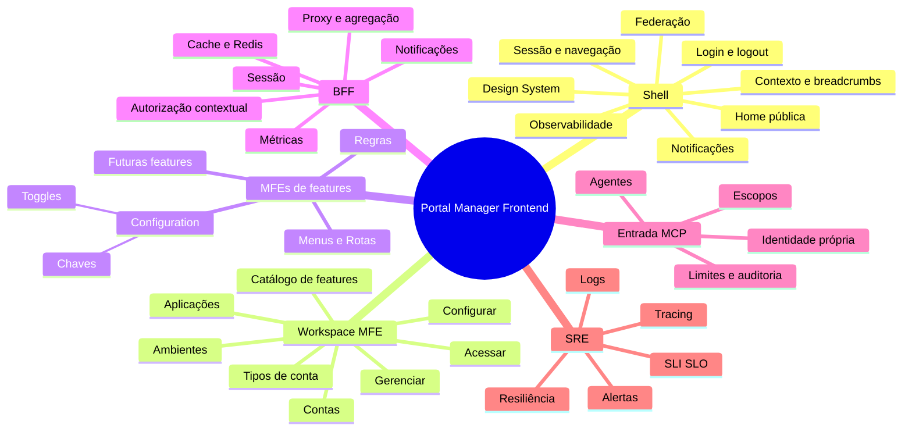
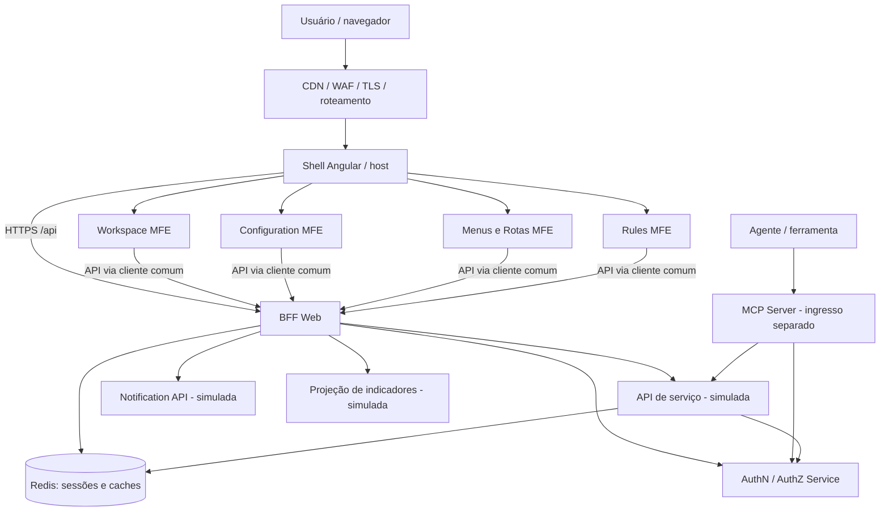
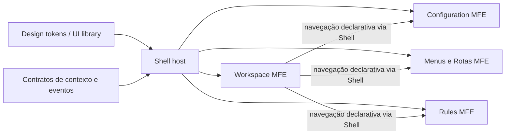
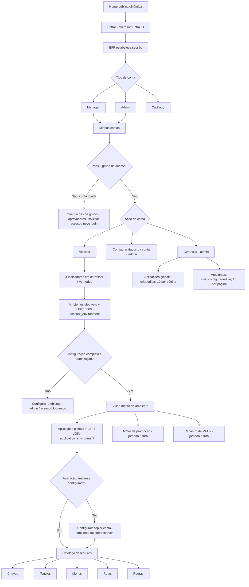
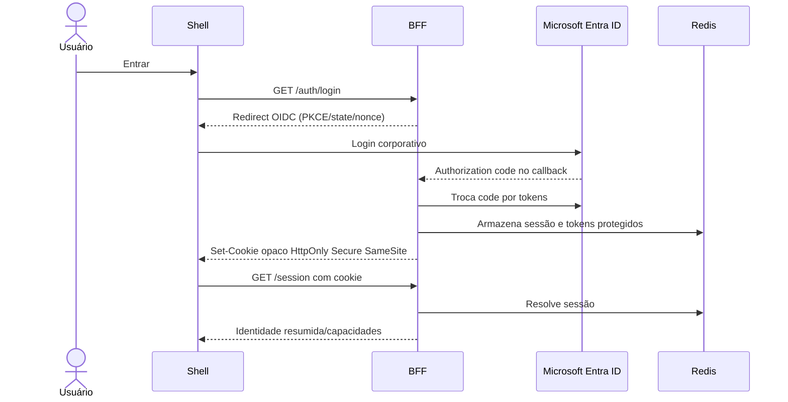
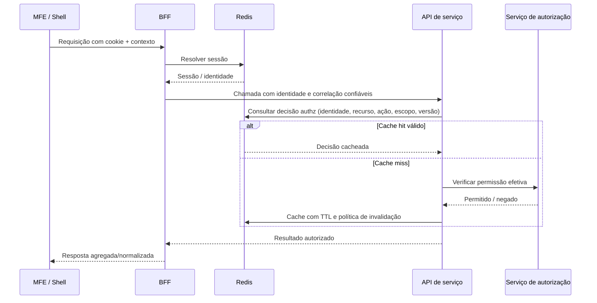
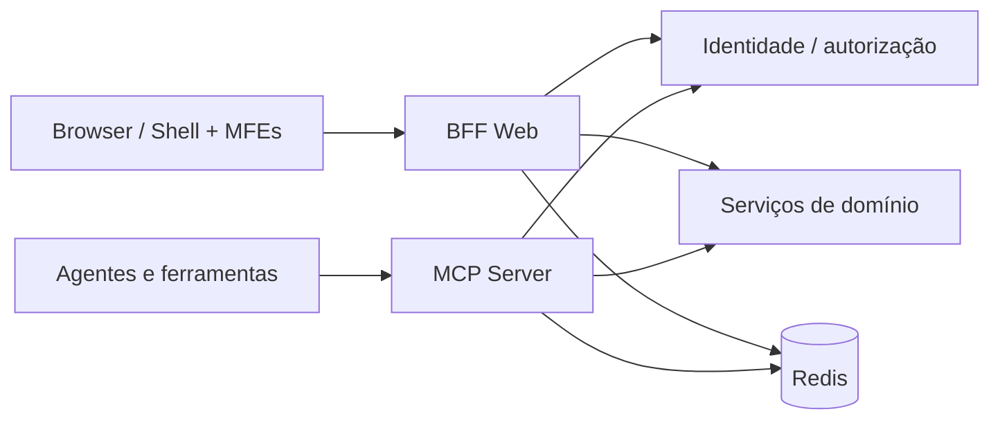
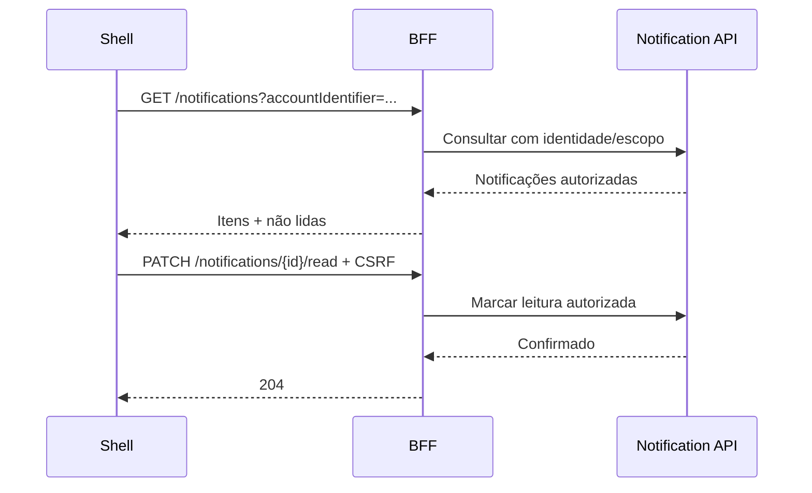
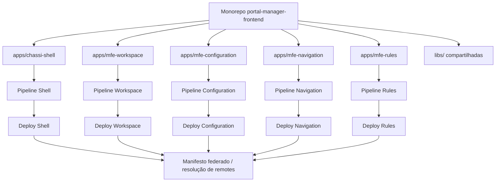

# 18 — Micro Frontends | Portal Manager
> Status: especificação de refinamento arquitetural (não implementação aprovada)  
> Escopo: Shell, Workspace MFE, MFEs de features, Design System, BFF, sessão, Redis, autorização, notificações, observabilidade, SRE e MCP como entrada paralela.  
> Data: 2026-10-17

## 1. Objetivo e fronteiras
Consolidar a experiência web e as responsabilidades técnicas da plataforma Portal Manager. A arquitetura prioriza baixo acoplamento, segurança, rastreabilidade e crescimento gradual de MFEs. A fronteira principal é o BFF; serviços de domínio são caixas-pretas neste refinamento, exceto a simulação do cache e da autorização. Nenhuma decisão deste documento substitui testes de carga, threat modeling ou aprovação corporativa.

### 1.1 Decisões já alinhadas
- Frontend Angular 22 como alvo do protótipo; confirmar versão efetivamente suportada e matriz de compatibilidade no início da implementação. Native Federation para integração Shell/remotes.
- Shell é host, responsável pela experiência transversal, não pelas regras de conta, ambiente ou aplicação.
- Workspace MFE é a porta de entrada funcional após login, iniciando na escolha de tipo de conta: MANAGER, ADMIN ou CATALOG.
- Features de Chaves, Toggles, Menus/Rotas e Regras serão MFEs independentes, carregados sob demanda.
- BFF é porta de entrada web e agregador/proxy; MCP é outra porta de entrada, separada, com limites e autenticação próprios.
- Sessão web por cookie opaco Secure, HttpOnly e SameSite; dados de sessão e tokens protegidos no backend, com Redis.
- Um cluster Redis inicial pode atender múltiplos usos com prefixos, políticas e controles independentes; prefixos não constituem isolamento de segurança.
- Home pública dinâmica: Shell renderiza avisos públicos ativos vindos de endpoint público do BFF, sem deploy.
- Notificações pessoais assíncronas no sino do Shell são diferentes de comunicados públicos.
- Contexto funcional do Shell em memória e sessionStorage por aba, sem segredos; autorização nunca depende do storage do navegador.
- O backend valida autorização, escopo dos identificadores, completude de configurações e regras de negócio.

## 2. Mapa mental


## 3. Arquitetura ponta a ponta

O navegador não se comunica diretamente com microserviços. O BFF não deve repassar um token arbitrário fornecido pelo JavaScript; credenciais ficam no backend. MCP não deve compartilhar automaticamente a sessão web nem contornar políticas dos serviços.

## 4. Matriz de responsabilidades
| Componente | Responsabilidades | Não deve fazer |
|---|---|---|
| Shell | Host, login/logout, rotas, layouts, breadcrumbs, contexto genérico, design system, sino de notificações, fallback de erro, carregamento de remotes, telemetria frontend | Regras de conta, ambiente, aplicação ou feature |
| Workspace MFE | Seleção de tipo de conta, contas, autorização visual, onboarding, dashboards, ambientes, aplicações, entrada no catálogo de features | Guardar token, impor autorização definitiva, implementar features de outros domínios |
| MFEs de feature | UI e fluxos de seu domínio, formulários, validação client-side, navegação local | Sessão própria ou dependência direta de outro remote |
| BFF | Sessão, cookies, CSRF, APIs públicas/privadas, proxy, composição de respostas, tratamento de falhas, rate limit, correlação, telemetria, cache apropriado | Persistir regras de negócio próprias ou substituir autorização do serviço |
| Serviço de autorização | Verificar identidade, grupos, recurso, ação e escopo | Confiar apenas na UI |
| API de serviço | Autorizar novamente e executar contrato do domínio; usar cache autorizado | Aceitar contexto não validado como prova de acesso |
| MCP Server | Identidade e autorização de agentes, catálogo de tools, limites, auditoria, execução permitida | Reutilizar automaticamente cookie web ou ter bypass de segurança |
| Redis | Sessão e caches separados por namespace/TTL/política | Ser fonte única e permanente de verdade |

## 5. Shell: módulos e contratos
### 5.1 Estrutura sugerida
- `core/auth`: estado de sessão, login redirect, callback via BFF, logout, idle/expiration, 401.
- `core/context`: API genérica `setContext`, `getContext`, `clearContext`, evento de alteração.
- `core/federation`: manifest/versionamento de remotes, lazy loading, erro e retry controlado.
- `core/navigation`: header, menu global, breadcrumbs, estados de loading e empty state.
- `core/notifications`: sino, contagem, lista, leitura, navegação para destino autorizado.
- `core/observability`: traces de navegação, erros, métricas Web Vitals, correlation ID.
- `shared/design-system`: tokens, componentes, acessibilidade, temas e responsividade.
- `public/home`: banners, carrosséis e cards públicos dinâmicos.
- `shared/api-client`: cliente HTTP com credenciais same-origin, timeout, retry seletivo e erros normalizados.

### 5.2 Contexto de navegação
```json
{
  "accountIdentifier": "uuid",
  "environmentIdentifier": "uuid",
  "applicationIdentifier": "uuid",
  "accountEnvironmentIdentifier": "uuid",
  "applicationEnvironmentIdentifier": "uuid"
}
```
Os três primeiros identificam entidades de negócio; os dois últimos, vínculos já resolvidos. São referências auxiliares, **não** permissões. `featureCode` é preferencialmente identificado pela rota/catálogo de features, sem obrigação de permanecer no contexto global. Ao mudar conta, limpar ambiente, aplicação e ambos os vínculos. Ao mudar ambiente, limpar aplicação e `applicationEnvironmentIdentifier`. Ao mudar aplicação, limpar vínculo anterior. Validar consistência no BFF e no serviço. Persistir somente identificadores não sensíveis em `sessionStorage`, com schema/versionamento e limpeza no logout; a sessão autenticada é exclusivamente server-side. Sincronização entre abas, se desejada, exige decisão específica: `sessionStorage` é por aba.

### 5.3 Federation e dependências

As setas Workspace → feature indicam navegação, não importação direta de código. MFEs não devem importar componentes internos de outro MFE. Contratos públicos versionados e compatibilidade entre Shell e remotes; fallback para remote indisponível e rollback independente. Avaliar import maps/manifest assinado, CSP e integridade da cadeia de publicação.

## 6. Experiência e fluxos

**Detalhes de UX:** ações Acessar/Configurar/Gerenciar ficam nos cards de contas para usuários elegíveis; Configurar e Gerenciar são administrativas. Indicadores aparecem apenas em Acessar, não em Gerenciar. Ambiente global DEFAULT é associado/configurado na conta, não recriado. A existência do vínculo não implica configuração completa. Aplicação é global à conta; `application_environment` somente na jornada dentro do ambiente. Copiar dados de `account_environment` para `application_environment` cria snapshot independente, sem herança dinâmica; alterações posteriores na origem não propagam. Catálogo de features por cards, com possível menu lateral após entrada em uma feature.

## 7. BFF: endpoints conceituais
| Método / rota ilustrativa | Autenticação | Função |
|---|---|---|
| GET /public/notices | Pública | Comunicados vigentes por prioridade/área |
| GET /auth/login | Pública | Iniciar fluxo OIDC corporativo |
| GET /auth/callback | Fluxo OIDC | Validar state/nonce e estabelecer sessão |
| POST /auth/logout | Sessão + CSRF | Revogar/encerrar sessão |
| GET /session | Sessão | Perfil resumido e capacidades de UI |
| GET /workspace/account-types | Sessão | Tipos elegíveis |
| GET /workspace/accounts?type=... | Sessão | Contas visíveis |
| GET /workspace/accounts/{id}/overview | Sessão | Indicadores agregados |
| GET /workspace/accounts/{id}/environments | Sessão | Ambientes elegíveis e status de vínculo |
| GET /workspace/environments/{id}/applications | Sessão | Aplicações globais e configuração no ambiente |
| GET /workspace/applications/{id}/features | Sessão | Features disponíveis e navegáveis |
| GET /notifications | Sessão | Notificações da identidade e contexto |
| PATCH /notifications/{id}/read | Sessão + CSRF | Marcar como lida |

Rotas são propostas, não contratos definitivos. Definir paginação, ETag, semântica de 204/403, versionamento, OpenAPI, envelopes de erro e headers de contexto em refinamento. Endpoints de mutação são proxies com validação de escopo e CSRF; backend mantém regras.

## 8. Login, sessão e segurança

Cookie opaco não deve ser acessível a JavaScript. Evitar access/refresh tokens no browser. Implementar proteção CSRF para mutações (SameSite não basta), rotação de sessão, revogação no logout, idle e absolute timeout configuráveis, rate limiting e proteção de login/callback. Reduzir exposição de PII em logs e métricas. Autorização de grupos é atualizada após novo login, conforme onboarding corporativo; política de invalidação/revogação extraordinária permanece decisão de segurança.

## 9. Redis, cache e autorização
Namespaces sugeridos: `session:`, `authz:`, `bff:projection:`, `public:notices:`, `notifications:count:`. Preferir credenciais/ACL separadas por aplicação, TLS, TTL por categoria, limite de memória, métricas de hit/miss e política de eviction coerente. Sessões devem ter política de durabilidade e capacidade diferente de caches descartáveis; um cluster físico único é opção inicial, não isolamento garantido.


**Regras:** a chave do cache de autorização deve incluir principal, recurso, ação, contexto e versão/epoch de política quando aplicável; nunca usar apenas ID da conta. Caches de negação e permissão podem ter TTLs diferentes. TTLs de 1h/24h discutidos anteriormente são hipóteses, não aprovação para autorização; privilegiar revogação, invalidação e TTL conservador. Cache de dados do BFF deve variar por identidade/escopo quando personalizado. Não cachear indiscriminadamente respostas sensíveis. Falha do Redis em autorização exige política explícita fail-closed ou fallback seguro para o serviço de autorização; nunca assumir permissão por indisponibilidade.

## 10. MCP como porta de entrada paralela

MCP deve possuir autenticação de cliente/usuário apropriada, scopes por tool, rate limits independentes, auditoria de invocação, autorização de recurso no backend e defesa contra prompt injection/tool misuse. Proibir ferramentas genéricas irrestritas para escrita; separar leitura e mutação, com aprovação para ações críticas. Não acoplar agentes ao cookie de sessão web. A identidade propagada aos serviços deve ser verificável e a origem (web ou MCP) rastreável.

## 11. Notificações e home pública
Comunicados públicos: dados configuráveis (título, descrição, imagem/link opcionais, prioridade, início, expiração, status, ordem, placement banner/carrossel/cards), filtrados no backend para ativos/vigentes; Shell apenas renderiza, com sanitização de links e mídia e cache público de TTL curto/invalidação. Administração fora do Shell.

Notificações pessoais: sino global no Shell; listagem e contagem obtidas via BFF, filtradas por usuário e conta/contexto autorizado; paginação e marcação de leitura. Preferir polling com backoff na POC, evoluindo para SSE/WebSocket se necessidade de latência justificar. O BFF faz proxy para Notification API; serviço próprio de notificações mantém persistência e regras. Não misturar comunicado público e notificação individual.



## 12. Design System e experiência
**Decisão definida: adotar o Design System corporativo oficial, sem criar um Design System próprio.** Consumir seus tokens de cor, tipografia, espaçamento, radius, sombras, densidade, ícones, grid e breakpoints e seus componentes disponíveis (botão, input, select, modal, toast, badge, card, tabela, paginação, breadcrumb, skeleton, empty/error state, navegação e acessibilidade). Componentes não disponíveis devem seguir o processo de extensão e governança corporativa, não forks locais independentes. Alvo WCAG 2.2 AA, foco visível, teclado, contraste, semântica, labels, suporte a zoom e leitores de tela. Inspirar-se na experiência visual corporativa sem copiar ativos proprietários não licenciados. Shell entrega layout e tema; MFEs consomem biblioteca versionada, evitando CSS global que vaze entre remotes. Formulários dinâmicos JSON Schema usam renderer com adaptadores do Design System, mantendo validação definitiva no backend. Estratégia de internacionalização PT-BR/EN e timezone por usuário deve ser refinada.

## 13. Observabilidade e SRE
- Instrumentar frontend com Web Vitals (LCP, INP, CLS), tempo de bootstrap do Shell, tempo de carregamento do remote, erro de chunk, falha de navegação, latência de BFF e falha de autenticação.
- OpenTelemetry em BFF e serviços; propagação `traceparent`/correlation ID sem aceitar identidade de headers arbitrários. Logs estruturados sem tokens, cookies ou payloads sensíveis.
- Painéis por rota, remote, versão, tipo de erro, dependência, percentis p50/p95/p99, taxa de 401/403/429/5xx, Redis hit/miss, conexões e expiração de sessão.
- SLOs iniciais propostos para discussão: disponibilidade BFF, sucesso de login, carregamento de Shell e transição para Workspace; estabelecer baselines medidos antes de definir números.
- Alertas por burn rate de error budget, indisponibilidade de remote, elevação de 5xx, falha no IdP, saturação Redis e degradação de autenticação.
- Resiliência: timeout, retry apenas idempotente e com jitter, circuit breaker nas integrações, bulkhead, graceful degradation de indicadores/comunicados, erro isolado de remote e página de recuperação.
- CI/CD: testes unitários, contrato e integração, acessibilidade, E2E das jornadas críticas, bundle budgets, SCA/SAST, CSP, revisão de dependências, publicação de manifest, canary/rollback, compatibilidade Shell↔remote.
- SRE operacional: runbooks para login, remote fora, cache indisponível, notificações atrasadas, BFF lento e autorização degradada; ownership e plantão por componente.
- Privacidade: minimização de PII, retenção e amostragem de telemetria, mascaramento, política LGPD e consentimento quando aplicável.

## 14. Contratos, erros e estados
Erros padronizados: `code`, `message`, `detail`, `suggestion`, `correlationId`, `timestamp` conforme contrato existente de mensagens. UI distingue 401 (sessão expirada; reautenticar), 403 (sem acesso), 404 (recurso não encontrado), 409 (conflito/versão), 422/400 (validação) e 429 (limite). Para usuário criador sem grupos, Workspace apresenta fallback instrutivo, não tela genérica de erro. Requisições em voo devem ser canceladas ao trocar contexto para evitar dados cruzados. Uso de idempotency keys em operações sensíveis a repetição deve ser avaliado.

## 15. Estratégia de implementação por ondas
| Onda | Entregas | Critério de aceite |
|---|---|---|
| 0 — Contratos | ADRs, mapa de rotas, tipos de contexto, erros, auth/session, contratos BFF, tokens do DS | Contratos revisados e versionados |
| 1 — Shell base | Host, home pública, login simulado→real, sessão, layout, design system, observabilidade mínima | E2E login/logout e fallback |
| 2 — Workspace | Tipos, contas, visibilidade restrita, ações, indicadores, ambientes, aplicações, catálogo de features | Fluxo navegável e regras de bloqueio testadas |
| 3 — Federation | Manifest, lazy remotes de exemplo, integração com Shell, rollback | Remote independente e erro isolado |
| 4 — BFF/cache | Sessão Redis, agregações, autorização, contratos API, cache seguro | Testes de isolamento, hit/miss, revogação e CSRF |
| 5 — Notificação/MCP/SRE | Sino, comunicados, MCP independente, tracing, painéis, alertas | Observabilidade e testes de segurança/carga |

Dependências: Shell/DS/contratos antecedem Workspace; Workspace depende do BFF e expõe seleção de feature; MFEs de feature dependem do contrato de navegação e contexto, não de código interno do Workspace. MCP pode evoluir paralelamente após contratos de identidade/autorização.

## 16. Cenários de teste ponta a ponta
1. Home sem login mostra apenas comunicados públicos vigentes.
2. Login corporativo cria sessão server-side e cookie opaco; JS não acessa tokens.
3. Após login aparece seleção MANAGER/ADMIN/CATALOG antes de contas.
4. Criador sem grupos vê conta restrita e instruções; após concessão de grupo é necessário novo login.
5. Acessar exibe quatro indicadores e todos sob demanda; Gerenciar não duplica dashboard.
6. Consulta de ambientes inclui elegíveis não configurados (LEFT JOIN) e bloqueia acesso.
7. Admin configura ambiente com dados obrigatórios e então acesso é liberado.
8. Aplicação criada globalmente não cria `application_environment` automaticamente.
9. Dentro de ambiente, aplicação sem vínculo configurado aparece pendente; acesso bloqueado.
10. Copiar configuração conta–ambiente gera valores independentes; alterar origem não altera destino.
11. Catálogo de features navega para remote correto e preserva contexto válido.
12. Troca de conta/ambiente limpa dependentes; chamadas atrasadas não exibem dados do contexto anterior.
13. Cache authz miss chama serviço de autorização; hit respeita escopo; revogação é testada.
14. Remote indisponível não derruba Shell; mensagem de erro e retorno seguro.
15. Notificações de outra conta/usuário nunca são expostas.
16. MCP não consegue reutilizar sessão web nem ultrapassar scopes e limites.

## 17. Pontos abertos para refinamento
- Versões exatas de Angular, Native Federation, Node, TypeScript e política de suporte.
- Monorepo de MFEs versus múltiplos repositórios; processo de publicação/manifest.
- Confirmar pacote, versão, documentação, acesso e política de atualização do **Design System corporativo já definido como obrigatório**.
- Política de cookie SameSite conforme domínios efetivos, CSRF, refresh/idle/absolute timeout, SSO/logout global.
- Modelo de autenticação do MCP, delegação de usuário, autorização de tools e aprovação de mutações.
- TTL e invalidação de authz, estratégia fail-closed/fallback, separação futura do Redis.
- Esquema definitivo dos identificadores e headers de contexto, compatibilidade com APIs existentes.
- Endpoints agregados do BFF, limites de paginação, projeção de indicadores e SLA de atualização.
- Entrega de notificações via polling, SSE ou WebSocket; retenção e autorização por contexto.
- Contrato do catálogo dinâmico de features e feature flags por conta/aplicação/ambiente.
- Responsabilidade e localização do motor de promoção e cadastro de MFEs.
- Métricas/SLOs e limiares concretos baseados em medições reais.
- Padrão de deploy, WAF/CDN, CSP, CORS, observabilidade e runbooks corporativos.

## 18. Princípios de aceite arquitetural
O Shell é infraestrutura de experiência, o Workspace é navegação de negócio, cada MFE é dono da própria feature, o BFF é a fronteira web e o MCP é a fronteira de agentes. Contexto não é autorização. Redis acelera, mas não substitui fonte de verdade nem política de revogação. Configurações copiadas são snapshots, não herança referencial. Todas as jornadas devem ser testáveis com mocks antes de conectar serviços reais.

## 19. Estratégia de repositórios — monorepo versus multirepositório

> **Diretriz preferencial para refinamento: MONOREPO com autonomia real por MFE.** Esta é uma recomendação arquitetural, não uma imposição irreversível. A validação final deverá considerar governança, segurança, escala de equipes e compatibilidade da stack.

### 19.1 Premissas
- A plataforma começa com poucos times, mas poderá distribuir Shell, Workspace e features para equipes distintas.
- O frontend terá Angular e Native Federation; a adoção de Nx deve ser validada com as versões efetivas de Angular, Node, TypeScript e plugins.
- Cada MFE precisa de ownership, build, testes, release, observabilidade e deploy independentes.
- O BFF e o MCP Server são **projetos backend separados**, fora do monorepo exclusivamente frontend.
- O repositório `guideline-java` permanece como local de documentação e POCs; a base de produto seria `portal-manager-frontend`.
- A localização do código em um mesmo repositório não significa acoplamento de runtime: remotes são aplicações independentes carregadas pelo Shell.

### 19.2 Estratégia A — monorepo (favorita)
Um repositório `portal-manager-frontend`, gerenciado preferencialmente com Nx, contendo apps Angular e bibliotecas reutilizáveis.

```text
portal-manager-frontend/
├── apps/
│   ├── chassi-shell/            # host; login, sessão, layout, contexto, navegação
│   ├── mfe-workspace/           # contas, ambientes, aplicações, catálogo de features
│   ├── mfe-configuration/       # chaves e toggles
│   ├── mfe-navigation/          # menus e rotas
│   └── mfe-rules/               # regras
├── libs/
│   ├── corporate-ui-adapters/   # integração/adaptadores do Design System corporativo
│   ├── shell-contracts/         # contratos públicos de contexto, rotas e eventos
│   ├── api-client/              # cliente BFF e contratos HTTP
│   ├── observability/           # instrumentação frontend
│   └── testing/                 # fixtures e utilitários de testes
├── tools/                       # automações e scripts de workspace
├── nx.json
├── package.json
└── tsconfig.base.json
```

**Argumentos favoráveis:** uma única matriz de versões e padrões; revisão transversal de contratos; integração e testes ponta a ponta facilitados; compartilhamento disciplinado de bibliotecas; experiência de desenvolvimento local simples; pipelines por projetos afetados com cache de build; evolução inicial mais rápida para um time pequeno. Uma biblioteca comum de Design System reduz divergência visual, enquanto os contratos do Shell podem ser testados contra todos os remotes.

**Custos e riscos:** dependências compartilhadas mal delimitadas podem gerar acoplamento; mudanças globais podem afetar múltiplos projetos; controle de acesso ao código é menos granular; CI mal configurada pode virar gargalo; divergências entre times exigem ownership explícito. Mitigações: regras de dependência do Nx, CODEOWNERS, revisão obrigatória por responsáveis, boundaries de domínio, políticas de versões, testes de contrato, pipeline seletiva e artefatos/deploys separados.

**Condição obrigatória:** não criar uma aplicação Angular raiz que importe todas as features como módulos estáticos. O Shell é um app host, Workspace e features são apps remotos independentes. Não permitir importação de código interno entre MFEs; comunicação via contratos públicos, rotas e API de contexto do Shell.

### 19.3 Estratégia B — multirepositório
Um repositório por aplicação e, quando necessário, por biblioteca:

```text
portal-shell
portal-mfe-workspace
portal-mfe-configuration
portal-mfe-navigation
portal-mfe-rules
portal-design-system
portal-shell-contracts
portal-api-client
```

**Argumentos favoráveis:** ownership e permissões de acesso mais isolados; ciclos de release totalmente separados; adoção de políticas específicas por equipe; menor risco de alterações acidentais fora do domínio; fronteiras de responsabilidade mais visíveis. É adequado quando times são grandes, independentes ou sujeitos a controles diferentes.

**Custos e riscos:** manutenção de várias pipelines, configurações e templates; upgrades coordenados mais trabalhosos; integração local e testes entre remotes exigem tooling adicional; bibliotecas precisam ser publicadas em registry privado com SemVer; compatibilidade entre versões demanda contrato e matriz explícitos; mudanças transversais envolvem múltiplos pull requests. Requer uma equipe de plataforma para templates, automação de dependências, catálogos de versões e observabilidade comum.

### 19.4 Comparação
| Critério | Monorepo | Multirepositório |
|---|---|---|
| Início com um time pequeno | **Menor esforço** | Mais setup e governança |
| Padronização de Angular e tooling | **Centralizada** | Coordenada entre repositórios |
| Compartilhamento de DS/contratos | **Simples com limites** | Pacotes versionados |
| Builds e deploys independentes | **Sim, com pipelines por app** | Sim, naturalmente |
| Times independentes | Sim, com CODEOWNERS/boundaries | **Maior isolamento organizacional** |
| Controle de acesso por domínio | Limitado | **Mais granular** |
| Mudanças transversais | **Um PR pode cobrir vários projetos** | PRs coordenados |
| Risco de acoplamento | Exige enforcement técnico | Exige contratos publicados |
| Escala de CI | Requer affected builds e cache | Distribuição por repositório |
| Migração futura de equipes | Possível sem separar repositórios | Já separado |

### 19.5 Governança e deploys no monorepo
1. Cada app tem proprietário (CODEOWNERS), pipeline, testes, bundle budget, versão, deploy e rollback independentes.
2. Nx project boundaries impedem dependências diretas entre MFEs; `libs/` expõe apenas APIs públicas e segue regras de ownership.
3. Shell carrega remotes via manifesto/versionamento; publicar um remote compatível **não** exige rebuild do Shell.
4. Contratos Shell–MFE são versionados e sujeitos a testes de compatibilidade; breaking changes exigem janela de migração.
5. O **Design System corporativo é obrigatório e a fonte oficial** de componentes, tokens, temas e padrões. Bibliotecas locais contêm somente adaptadores e integrações quando necessários, sem recriar componentes oficiais. O consumo deve seguir o canal de distribuição, versionamento e licenciamento corporativo.
6. CI executa lint, typecheck, testes, security scanning e build somente nos projetos afetados, mais verificações transversais necessárias.
7. Cada remote gera artefato imutável, é distribuído independentemente e possui monitoramento por nome e versão.
8. Dependências globais (Angular, Native Federation, Nx) seguem política de atualização e validação de compatibilidade.



### 19.6 Como evoluir para múltiplos times
**Primeira etapa:** um monorepo, contratos bem delimitados e owners por domínio. **Segunda etapa:** times independentes permanecem no mesmo repositório com aprovação de código, pipelines e releases próprias. **Terceira etapa (opcional):** extrair um MFE para repositório próprio quando houver necessidade real de isolamento de acesso, compliance, política de release ou tooling incompatível. A extração deve preservar o contrato do Shell, o manifesto federado e a API do BFF, evitando mudança na experiência do usuário.

### 19.7 Recomendação registrada
**Preferir a Estratégia A — monorepo `portal-manager-frontend` com Nx, Angular e Native Federation**, com `apps/` para Shell e MFEs e `libs/` para Design System e contratos. **Não** incluir BFF/MCP como apps frontend. A opção multirepositório permanece válida e documentada para futura decisão organizacional. Critérios de revisão: número de times, requisitos de permissão, duração de builds, frequência de alterações transversais, maturidade das pipelines e necessidade de stacks distintas.

**Status da decisão:** favorita para implementação inicial; formalizar ADR após POC de Federation, build seletivo e deploy independente.

### 19.8 Decisão complementar — Design System corporativo
**Definido:** Shell, Workspace e todos os MFEs utilizarão o Design System corporativo oficial como fonte de verdade para identidade visual, componentes e acessibilidade. Não será criado um Design System próprio do Portal Manager. A pasta `libs/corporate-ui-adapters` (se necessária) conterá apenas wrappers técnicos, integração com Angular, composição de componentes e adaptações aprovadas; não substituirá nem duplicará o catálogo corporativo. Confirmar os pacotes oficiais, distribuição, versão suportada, tokens disponíveis e diretrizes de contribuição antes da implementação.
