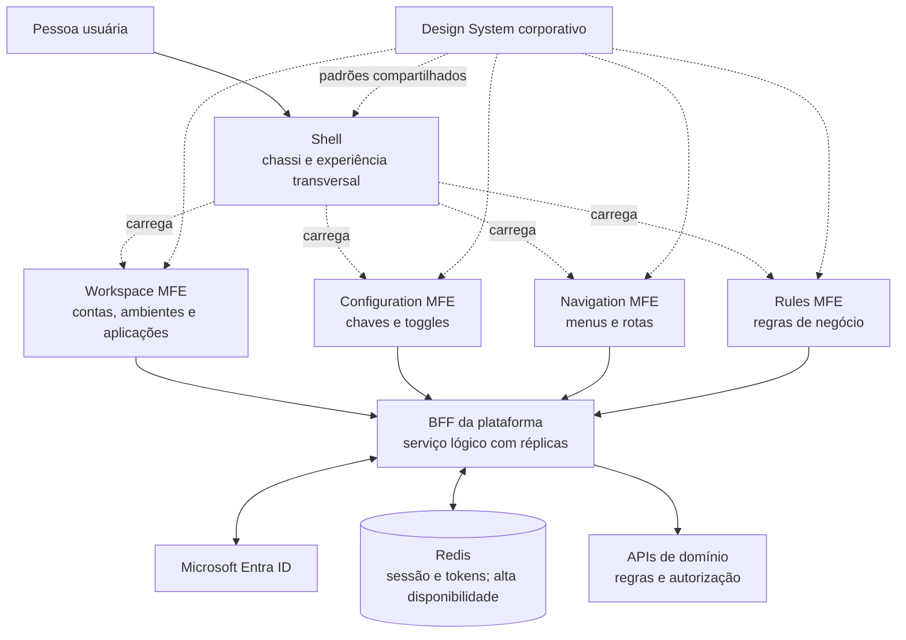

# Visão geral da arquitetura do Portal Manager

> Proposta greenfield para apresentação e alinhamento. O Shell/chassi e os MFEs ainda serão construídos; esta visão não representa capacidade já validada.

A experiência web é organizada em um **Shell**, a base da plataforma, que hospeda quatro micro frontends. O **Navigation MFE** reúne menus e rotas. Os MFEs acessam as APIs por **um BFF da plataforma**, compartilhado e escalável horizontalmente. O BFF mantém sessões e tokens no Redis.

## Visão macro

## Papéis principais

- **Shell:** chassi da plataforma; hospeda os MFEs e coordena layout, navegação global, contexto, mensagens e falhas transversais; aplica Design System, acessibilidade, idioma e observabilidade do frontend.
- **Workspace MFE:** contas, ambientes e aplicações.
- **Configuration MFE:** chaves e toggles.
- **Navigation MFE:** menus e rotas no mesmo MFE.
- **Rules MFE:** experiência de regras de negócio.
- **BFF da plataforma:** ponto de entrada backend compartilhado pelos MFEs; integra autenticação com o Microsoft Entra ID, administra sessão e intermedeia chamadas às APIs. É um serviço lógico, executado com réplicas para disponibilidade e escala horizontal.
- **Redis:** armazenamento compartilhado de sessão e tokens, projetado com alta disponibilidade.
- **APIs de domínio:** aplicam regras de negócio e autorização definitiva.

## Sessão e limites de segurança

O navegador recebe um cookie opaco e o envia nas chamadas web. A aplicação frontend não lê nem armazena tokens de acesso: o BFF mantém os tokens e os dados da sessão no backend, usando Redis. O Shell pode controlar a experiência de login, logout e expiração, mas a autorização real é validada nas APIs de domínio.

## Isolamento de manutenção

Os microserviços de domínio devem poder evoluir e ser implantados independentemente, desde que mantenham contratos compatíveis e sejam donos dos próprios dados. Uma alteração neles não deve exigir a republicação dos demais serviços.

O Shell e o BFF são componentes compartilhados da plataforma e, por isso, têm alcance de impacto maior. Mudanças neles precisam de compatibilidade, testes de integração/contrato, monitoramento e possibilidade de rollback. A falha de um MFE também deve ser tratada pelo Shell para reduzir o impacto nas demais áreas.

## Risco compartilhado e mitigação

Como todos os MFEs usam o mesmo BFF, indisponibilidade ou sobrecarga dele pode afetar o acesso às APIs por toda a plataforma. A proposta prevê réplicas horizontais do BFF, sessão fora das instâncias, Redis com alta disponibilidade, limites de tempo e isolamento nas chamadas às APIs, além de monitoramento e rollback.

Essas medidas são requisitos de arquitetura a validar; não significam que a capacidade já foi comprovada. A validação deve começar por uma fatia vertical — Shell, um MFE, BFF, Redis e uma API — com testes de carga, falha e recuperação.

## Enquadramento

Esta é uma visão macro de uma arquitetura greenfield para discussão e aprovação. Os contratos, topologia de implantação, metas de disponibilidade e detalhes de implementação permanecem para o detalhamento das próximas etapas.
