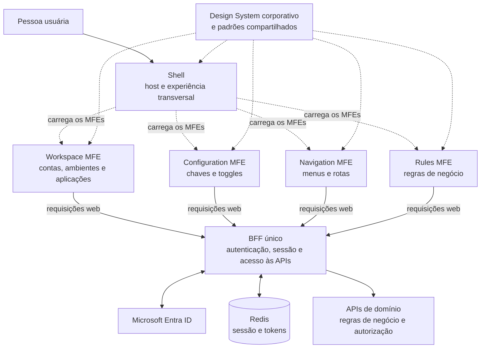

# Visão geral da arquitetura do Portal Manager

> Síntese para apresentação e alinhamento da arquitetura web.

A experiência web é organizada em um **Shell** que hospeda quatro micro frontends independentes. O **Navigation MFE** reúne a gestão de menus e rotas. Os MFEs acessam as APIs por um **BFF único**, que integra a autenticação e mantém a sessão no backend.

## Visão macro

## Papéis principais

- **Shell:** estrutura base; hospeda os MFEs; coordena layout, navegação global e contexto da experiência; apresenta mensagens e falhas transversais; aplica padrões de Design System, acessibilidade e idioma; observa carregamento e erros dos remotes.
- **Workspace MFE:** entrada funcional para contas, ambientes e aplicações.
- **Configuration MFE:** experiência de configuração de chaves e toggles.
- **Navigation MFE:** gestão de menus e rotas no mesmo MFE.
- **Rules MFE:** experiência de regras de negócio.
- **BFF único:** inicia e conclui o fluxo de autenticação com o Microsoft Entra ID, administra a sessão e intermedeia as chamadas às APIs.
- **APIs de domínio:** aplicam as regras de negócio e a autorização definitiva.

## Sessão e limites de segurança

O navegador recebe um cookie opaco e o envia automaticamente nas chamadas web. A aplicação frontend não lê nem armazena os tokens de acesso: o BFF mantém os tokens e os dados da sessão no backend, usando Redis. O Shell pode controlar a experiência de login, logout e expiração, mas a autorização real é validada nas APIs de domínio.

## Enquadramento

Esta visão resume os componentes e suas responsabilidades para apresentação. Os contratos e detalhes de implementação permanecem na especificação de refinamento.
