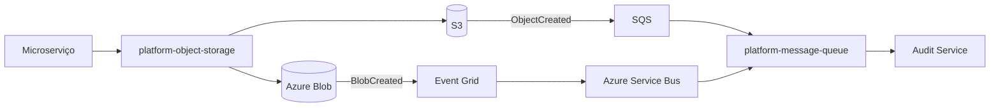

# Refinamento — Platform Object Storage (AWS S3 / Azure Blob)
Status: proposta para POC e implementação futura. Sem alteração de código produtivo.

## Objetivo e decisões
Criar um módulo Maven `platform-object-storage` na Platform Libraries, seguindo o padrão comprovado em `platform-message-queue`: um JAR, SDKs AWS e Azure no mesmo módulo, contratos independentes de provedor, auto-configurações condicionais e validação fail-fast. Seleção obrigatória por `platform.object-storage.provider=AWS|AZURE`. Somente o provedor selecionado registra seus beans; dependências dos dois SDKs permanecem no classpath. Evitar dependência de `platform-message-queue` para publicar eventos.

## Escopo funcional
- Upload por streaming, com destino lógico, object key, InputStream, comprimento conhecido, content type e metadados; não carregar arquivo inteiro em heap. Upload de tamanho desconhecido requer estratégia explícita (multipart/spooling controlado), nunca buffer ilimitado.
- Política padrão **CREATE_ONLY** (rejeitar chave existente); **OVERWRITE** somente por solicitação explícita. Implementar de forma atômica no provedor, sem HEAD seguido de PUT sujeito a corrida.
- Download por streaming da versão atual ou de versão específica; resposta `AutoCloseable` com stream, content type, tamanho, metadados, ETag, versionId opcional. Fechamento do stream é responsabilidade do chamador.
- HEAD/metadados, existência, exclusão com política explícita (versão atual vs versão identificada). Listagem paginada por prefixo é capacidade desejável, não requisito para primeira entrega.
- Resposta do upload: destino, chave, versionId opcional, ETag, tamanho e checksum SHA-256 quando calculado/verificado. ETag **não é equivalente universal a SHA-256**.
- Chaves e metadados comuns entre provedores. Prefixo e sufixo configuráveis por destino lógico, com normalização segura; impedir traversal, prefixos duplicados e colisões. Nunca inferir o bucket do usuário final.

## Contratos conceituais (nomes sujeitos à POC)
```java
interface ObjectStorageClient {
  UploadResult upload(UploadRequest request, InputStream content);
  DownloadResult download(String destination, String key, Optional<String> versionId);
  ObjectMetadata metadata(String destination, String key, Optional<String> versionId);
  boolean exists(String destination, String key);
  void delete(DeleteRequest request);
}
record UploadRequest(String destination, String key, long contentLength,
                     String contentType, Map<String,String> metadata,
                     WriteMode writeMode, Optional<String> sha256) {}
enum WriteMode { CREATE_ONLY, OVERWRITE }
```
Não expor `S3Client`, `BlobClient`, exceções ou modelos específicos dos SDKs na API pública. Mapear not-found, conflict, invalid configuration, access denied, timeout e erro transitório em exceções Golden, preservando causa e observabilidade.

## Configuração conceitual
```yaml
platform:
  object-storage:
    provider: AWS # ou AZURE
    aws:
      region: sa-east-1
    azure:
      endpoint: https://example.blob.core.windows.net
    destinations:
      audit-events:
        bucket: audit-events-prod       # AWS; para Azure usar container
        prefix: events/
        # container: audit-events-prod
```
A modelagem final pode ter campos `aws.bucket` e `azure.container` dentro do destino para evitar ambiguidade. Validar provider, destinos, nomes físicos, região/endpoint, credenciais resolvíveis e configurações obrigatórias no startup. Credenciais via cadeias padrão dos SDKs/identidade gerenciada; não registrar segredos. Não exigir configuração do provedor inativo. Segurança: IAM/RBAC mínimo, criptografia em repouso e TLS, sem ACL pública por padrão.

## Versionamento
Versionamento é capacidade configurada na infraestrutura, **não** flag por upload. AWS S3: versionamento no bucket. Azure Blob: versionamento na conta (com restrições conforme tipo de conta e recursos). `versionId` é opcional e opaco; download específico só quando suportado e disponível. Com versionamento desabilitado, sobrescrita substitui a versão atual; para auditoria usar UUID como chave e CREATE_ONLY. Não assumir equivalência perfeita entre exclusão/versionamento dos provedores.

## Eventos de armazenamento para filas

Notificações são provisionadas **na infraestrutura** (S3 Event Notifications -> SQS; Azure Blob -> Event Grid -> Service Bus). O upload não publica manualmente na fila. Não há transação distribuída entre upload e consumo. Entrega pode ser duplicada, atrasada e fora de ordem; consumer idempotente pelo identificador do evento, não pelo nome do arquivo. S3 e Event Grid têm envelopes diferentes: definir adaptadores/normalizadores de evento de storage na entrada do consumidor, sem pressupor que `platform-message-queue` já interprete esses formatos. Verificar filtros de prefixo/sufixo, permissões da fila, retries e DLQ. Evento de criação não substitui a verificação de conteúdo/checksum.

## Integração com auditoria
Outbox local -> publicador -> upload `CREATE_ONLY` com chave imutável baseada em eventId -> notificação nativa -> fila -> Audit Service. Persistir chave, destino/bucket lógico, versão (se houver), tamanho e SHA-256; o Audit Service valida integridade e insere evento idempotentemente. Falhas de upload não marcam outbox como entregue. Reprocessamento da mesma chave deve tratar conflito como possível sucesso **somente após conferir conteúdo/hash**, nunca aceitar conflito arbitrariamente.

## Requisitos de qualidade e testes
- Testes de integração com AWS S3 em LocalStack e Azure Blob em Azurite quando a funcionalidade for suportada; usar ambiente Azure real/teste específico para recursos não cobertos pelo emulador (especialmente versionamento/notificações).
- Upload/download streaming e arquivos grandes; CREATE_ONLY sob concorrência; OVERWRITE; metadados; checksums; UTF-8 e chaves inválidas; versão presente/ausente; exclusão; erros e permissões; fechamento de recursos.
- Testes de contexto Spring para provider AWS, AZURE, ausente, inválido e configuração incompleta; nenhum bean do provedor inativo.
- E2E notificações S3->SQS com LocalStack; Azure Blob->Event Grid->Service Bus em ambiente compatível; duplicatas, reordenação, retry e DLQ.
- Documentar dependências Maven, API pública, exemplos de YAML, métricas, logs sem payload e testes arquiteturais.
- Critérios de aceite: mesma API de negócio nos dois provedores, sem SDK exposto; CREATE_ONLY atômico; retorno de versão opcional; eventos nativos consumíveis com idempotência; `mvn clean verify` aprovado.

## Pendências para POC
Confirmar mecanismos condicionais de escrita e suporte de versionId nos SDKs escolhidos; estratégia para stream de comprimento desconhecido; política de retenção/exclusão; contratos de notificações; capacidade real do ambiente de testes Azure. Não implementar antes de estabilizar a main do ecossistema.
