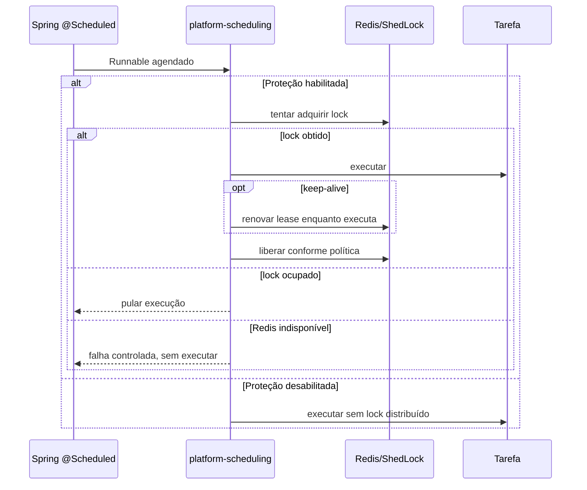

# Refinamento — Platform Scheduling (ShedLock + Redis)
Status: V1 integrada em `BrunoBS/platform-libraries` pelo PR #78 no commit `e7e9316796ac803bab70ce2407859c7d9ccd02f6`. O contrato abaixo reflete a decisão de permitir exclusão por tarefa e suportar publishers reativos com bloqueio da thread do scheduler.

## Objetivo
Criar módulo `platform-scheduling` que protege por padrão os métodos com `@Scheduled` do Spring contra execução concorrente entre instâncias do mesmo serviço, sem exigir `@SchedulerLock` ou nomes manuais. Um método pode optar por não usar lock com a anotação própria `@DisableScheduledLock`. ShedLock encapsulado na biblioteca, Redis como único backend de lock. A anotação `@Scheduled` continua determinando cron/fixedDelay/fixedRate; o lock não altera a frequência configurada. Para retorno `Mono` ou `Flux`, a thread do scheduler fica bloqueada até conclusão, erro ou cancelamento do publisher, mantendo o lock ativo durante a assinatura.

## Governança e evidência
A V1 foi integrada em `platform-libraries` pelo PR #78. A execução `Verify #1840` no commit da branch concluiu `mvn clean verify` com Java 25. A Golden Platform fixa o commit de merge pelo gitlink; o artefato Maven é publicado em fluxo de release separado.

## Dependências e responsabilidades
- Novo JAR `platform-scheduling` integra Spring Scheduling, ShedLock e `RedisLockProvider`.
- O microserviço declara **explicitamente** no POM tanto `platform-scheduling` quanto `platform-redis`; validar essa regra no build/arquitetura. A transitividade não substitui declaração explícita.
- Reutilizar o `RedisConnectionFactory` gerenciado pelo `platform-redis`, sem segunda conexão e sem tabelas SQL de ShedLock.
- Configuração/credenciais Redis pertencem ao microserviço; lock usa namespace estável do nome do serviço e não compartilha nomes com outros serviços.

## Configuração aprovada V1
```yaml
golden:
  scheduling:
    distributed-lock:
      enabled: true
      lock-at-most-for: PT10M
      lock-at-least-for: PT0S
      keep-alive: true
```
Os defaults e limites descritos foram implementados e cobertos por testes de configuração. Evitar TTL curto demais. Não há overrides de duração por tarefa. `@DisableScheduledLock` é uma exclusão pontual do lock, não um override de duração. Não exigir segunda propriedade de confirmação para `enabled=false`.

## Semântica
- `enabled=true` (padrão desejado): adquirir lock antes da execução real; se já ocupado, **pular** a invocação, sem fila implícita. Liberar ao término conforme semântica ShedLock e `lock-at-least-for`.
- `enabled=false`: Spring `@Scheduled` funciona normalmente, **sem proteção distribuída**. Log WARN explícito; não exigir Redis ativo apenas para scheduling.
- Redis indisponível ao iniciar com lock habilitado: falhar startup de forma clara. Redis indisponível antes da execução: **fail closed** (não executar tarefa desprotegida); startup indisponível com lock habilitado também falha.
- Perda de Redis durante tarefa em execução pode resultar em expiração do lock e concorrência; KeepAlive reduz risco, mas **não garante exclusividade absoluta**. Tarefas devem ser idempotentes e tolerantes a retries; quando apropriado, claim transacional no banco e leases.
- `lock-at-most-for` é duração máxima de lease sem renovação; `lock-at-least-for` é duração mínima do lock, não duração de execução; keep-alive tenta renovar periodicamente enquanto executa.

## Opt-out por tarefa e execução reativa

- `@DisableScheduledLock` exclui somente o método anotado; todas as demais tarefas seguem protegidas por padrão. A tarefa excluída executa sem coordenação distribuída.
- Para `Mono` e `Flux`, a biblioteca bloqueia a thread do scheduler até o publisher completar, falhar ou ser cancelado. Isso mantém o lock durante todo o processamento, com custo de ocupação do pool. O pool precisa ser dimensionado para duração e quantidade das tarefas; publishers que não terminam podem reter thread e lock indefinidamente.
- A exclusão por anotação é testada em integração para permitir execução concorrente entre duas instâncias; o suporte reativo é testado com contextos concorrentes para `Mono` e `Flux`.

## Descoberta automática e nomes
A integração protege o `Runnable` registrado pelo Spring por meio das APIs públicas de scheduling, sem depender de AOP no método anotado nem de campos privados do Spring. Os testes de integração exercitam tarefas agendadas em contextos Spring.

Identificador de lock determinístico: `<serviceName>:<fullyQualifiedClassName>:<methodName>:<scheduleDiscriminator>`. Considerar overloads, `@Schedules` repetidos, métodos herdados, proxies, múltiplos `TaskScheduler`, alterações de cron e múltiplas instâncias. Evitar identificadores dependentes de pod, hostname ou UUID aleatório.

## Fluxo


## Matriz de validação V1
1. Duas instâncias do mesmo serviço, mesmo cron: uma execução por janela; lock concorrente pula.
2. Dois serviços diferentes com classe/método iguais: locks independentes por namespace.
3. `cron`, `fixedRate`, `fixedDelay`, métodos repetidos, múltiplos schedulers, proxies e tarefas de longa duração.
4. KeepAlive durante execução maior que `lock-at-most-for`; verificar limites e renovação real; crash da instância e recuperação após lease.
5. Redis indisponível antes do start, antes da aquisição e durante a execução; comprovar fail-closed e documentar risco de split-brain.
6. `enabled=false`: todas as instâncias executam normalmente, sem exigir Redis apenas para scheduling.
7. Validação Maven/arquitetura da declaração explícita de `platform-redis`; testes de configuração inválida e defaults.
8. Integração com Testcontainers Redis, logs estruturados, métricas para adquirido/pulado/erro, sem logs repetitivos por tick.
9. Testar inicialização, shutdown e propagação de exceções de tarefas sem quebrar scheduler; evitar duplicação de execução por wrappers.
10. Publishers `Mono` e `Flux`: lock mantido até término; cancelamento e exceção liberam recursos; thread ocupada documentada.
11. `@DisableScheduledLock`: método marcado executa sem lock enquanto tarefas não marcadas permanecem protegidas.

## Critérios de aceite
- Aplicação usa `@Scheduled` sem anotação ShedLock; todas as tarefas são protegidas por padrão, com exceção explícita via `@DisableScheduledLock`.
- Exclusão distribuída demonstrada com duas instâncias reais e Redis Testcontainers.
- Mantém cron/fixedRate/fixedDelay do Spring; pula a invocação quando lock não é adquirido. Para `Mono` e `Flux`, bloqueia intencionalmente a thread do scheduler até o publisher terminar, mantendo o lock durante toda a execução.
- Fail-closed comprovado, bypass explícito documentado, renovação comprovada e limites conhecidos.
- Sem tabelas SQL de lock; mesma conexão Redis; regras de dependências verificáveis.
- `mvn clean verify` com integração e arquitetura aprovados, documentação de configuração e observabilidade.

## Não escopo V1
Overrides de duração por tarefa, múltiplos provedores de lock, fila de tarefas puladas, exactly-once, eleição de líder genérica ou garantia de cancelamento automático se Redis cair. Se a interceptação universal de `@Scheduled` não for viável sem comportamento surpreendente, registrar evidências e **não** forçar implementação; reavaliar contrato em decisão arquitetural.
