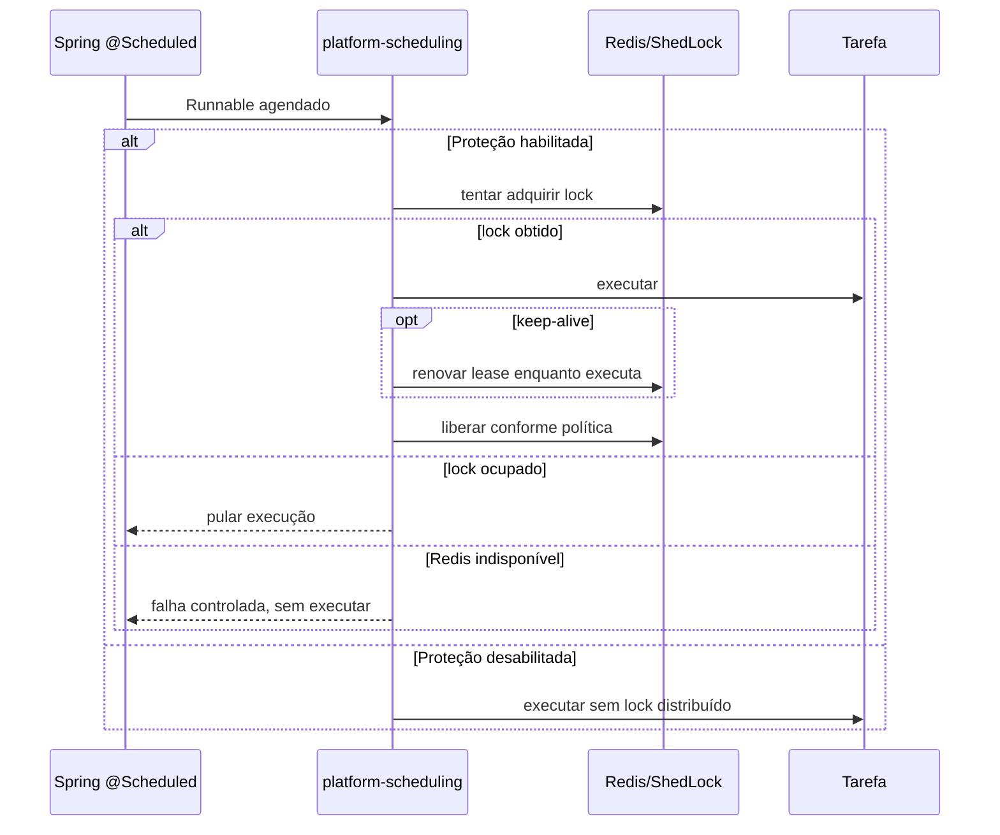

# Refinamento — Platform Scheduling (ShedLock + Redis)
Status: POC primeiro, implementação futura. Não alterar Audit Service ou Platform Libraries produtivos neste refinamento.

## Objetivo
Criar módulo `platform-scheduling` que protege **automaticamente** todos os métodos com `@Scheduled` do Spring contra execução concorrente entre instâncias do mesmo serviço, sem exigir `@SchedulerLock`, anotação Golden ou nomes manuais. ShedLock encapsulado na biblioteca, Redis como único backend de lock. A anotação `@Scheduled` continua determinando cron/fixedDelay/fixedRate; o lock não altera a frequência configurada.

## Pré-requisitos e governança
Aguardar Codex concluir trabalho atual; sincronizar main de Audit Service, Platform Libraries e Golden Platform, versões publicadas e gitlinks. Criar branch de POC isolada. Não assumir viabilidade da interceptação antes de validar com Spring Boot 4.1.1 / Spring Framework correspondente e versão efetiva de ShedLock.

## Dependências e responsabilidades
- Novo JAR `platform-scheduling` integra Spring Scheduling, ShedLock e `RedisLockProvider`.
- O microserviço declara **explicitamente** no POM tanto `platform-scheduling` quanto `platform-redis`; validar essa regra no build/arquitetura. A transitividade não substitui declaração explícita.
- Reutilizar o `RedisConnectionFactory` gerenciado pelo `platform-redis`, sem segunda conexão e sem tabelas SQL de ShedLock.
- Configuração/credenciais Redis pertencem ao microserviço; lock usa namespace estável do nome do serviço e não compartilha nomes com outros serviços.

## Configuração proposta
```yaml
golden:
  scheduling:
    distributed-lock:
      enabled: true
      lock-at-most-for: PT10M
      lock-at-least-for: PT0S
      keep-alive: true
```
Valores são **proposta para validar na POC**, não defaults homologados. Verificar limites de duração e comportamento real do `KeepAliveLockProvider`; evitar TTL curto demais. Não incluir overrides por tarefa na V1. Não exigir segunda propriedade de confirmação para `enabled=false`.

## Semântica
- `enabled=true` (padrão desejado): adquirir lock antes da execução real; se já ocupado, **pular** a invocação, sem fila implícita. Liberar ao término conforme semântica ShedLock e `lock-at-least-for`.
- `enabled=false`: Spring `@Scheduled` funciona normalmente, **sem proteção distribuída**. Log WARN explícito; não exigir Redis ativo apenas para scheduling.
- Redis indisponível ao iniciar com lock habilitado: falhar startup de forma clara. Redis indisponível antes da execução: **fail closed** (não executar tarefa desprotegida). Confirmar comportamento concreto do provider e interceptação.
- Perda de Redis durante tarefa em execução pode resultar em expiração do lock e concorrência; KeepAlive reduz risco, mas **não garante exclusividade absoluta**. Tarefas devem ser idempotentes e tolerantes a retries; quando apropriado, claim transacional no banco e leases.
- `lock-at-most-for` é duração máxima de lease sem renovação; `lock-at-least-for` é duração mínima do lock, não duração de execução; keep-alive tenta renovar periodicamente enquanto executa.

## Descoberta automática e nomes
A POC deve comprovar interceptação do **Runnable realmente registrado pelo Spring**, não apenas chamada direta ao método/proxy. Investigar `ScheduledAnnotationBeanPostProcessor`, `ScheduledTaskRegistrar`, `TaskScheduler` e APIs de decoração disponíveis, usando API programática ShedLock (`DefaultLockingTaskExecutor` / `LockProvider` / `KeepAliveLockProvider`). Não assumir que AOP em método anotado funciona para todos os agendamentos.

Identificador de lock determinístico: `<serviceName>:<fullyQualifiedClassName>:<methodName>:<scheduleDiscriminator>`. Considerar overloads, `@Schedules` repetidos, métodos herdados, proxies, múltiplos `TaskScheduler`, alterações de cron e múltiplas instâncias. Evitar identificadores dependentes de pod, hostname ou UUID aleatório.

## Fluxo


## Matriz obrigatória da POC
1. Duas instâncias do mesmo serviço, mesmo cron: uma execução por janela; lock concorrente pula.
2. Dois serviços diferentes com classe/método iguais: locks independentes por namespace.
3. `cron`, `fixedRate`, `fixedDelay`, métodos repetidos, múltiplos schedulers, proxies e tarefas de longa duração.
4. KeepAlive durante execução maior que `lock-at-most-for`; verificar limites e renovação real; crash da instância e recuperação após lease.
5. Redis indisponível antes do start, antes da aquisição e durante a execução; comprovar fail-closed e documentar risco de split-brain.
6. `enabled=false`: todas as instâncias executam normalmente, sem exigir Redis apenas para scheduling.
7. Validação Maven/arquitetura da declaração explícita de `platform-redis`; testes de configuração inválida e defaults.
8. Integração com Testcontainers Redis, logs estruturados, métricas para adquirido/pulado/erro, sem logs repetitivos por tick.
9. Testar inicialização, shutdown e propagação de exceções de tarefas sem quebrar scheduler; evitar duplicação de execução por wrappers.

## Critérios de aceite
- Aplicação usa somente `@Scheduled`, sem código ou anotação ShedLock.
- Exclusão distribuída demonstrada com duas instâncias reais e Redis Testcontainers.
- Não modifica semântica Spring além de pular execução quando lock não é adquirido.
- Fail-closed comprovado, bypass explícito documentado, renovação comprovada e limites conhecidos.
- Sem tabelas SQL de lock; mesma conexão Redis; regras de dependências verificáveis.
- `mvn clean verify` com integração e arquitetura aprovados, documentação de configuração e observabilidade.

## Não escopo V1
Override de duração por tarefa, múltiplos provedores de lock, fila de tarefas puladas, exactly-once, eleição de líder genérica ou garantia de cancelamento automático se Redis cair. Se a interceptação universal de `@Scheduled` não for viável sem comportamento surpreendente, registrar evidências e **não** forçar implementação; reavaliar contrato em decisão arquitetural.
