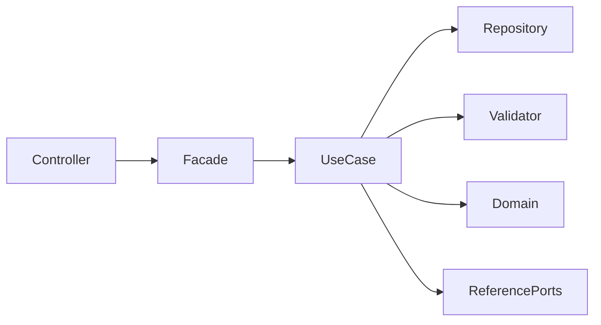

# Refinamento V2 — Configurações por ambiente da Golden

**Status:** refinamento funcional e arquitetural fechado para aprovação; verificações técnicas de implementação listadas como pré-requisitos do Codex.

**Natureza:** proposta documental; nenhuma implementação autorizada. **Referência:** Golden `BrunoBS/account-service` no commit `e87aefd07d11175e11e9fc8ca99752d60bd75bc5`.

## Decisões aprovadas

Dois agregados independentes: `WorkspaceEnvironmentConfiguration` e `ApplicationEnvironmentConfiguration`, com settings JSON próprios, versão otimista, lifecycle e publishers ordenados. Não modificar settings cadastrais existentes. Arquitetura obrigatória: **Controller → Facade → Use Case → Repository**. `CommandService` e `QueryService` são implementações de Use Case, não camada adicional. DEV consulta; ADM cria, edita, inativa e coloca em quarentena. Lifecycle `ACTIVE → INACTIVE → QUARANTINED`, sem exclusão física. A restauração fica para refinamento posterior.

Publisher Workspace (WebSocket/Kafka) é compatível com Workspace e Application; publisher Application (WebConfig) apenas com Application. Publisher `deprecated` continua elegível; INACTIVE não pode entrar em novas associações, mas permanece nas antigas. **Códigos definitivos aprovados:** `HTTP` (denominação funcional WebSocket), `KAFKA` (Kafka), `APPCONFIG` (denominação funcional WebConfig). Os códigos persistidos e expostos pela API são exclusivamente os existentes no Account Service. A equivalência HTTP/WebSocket é de nomenclatura de negócio, **não de protocolo nem prova de implementação WebSocket**. Escopos seguem a regra aprovada: HTTP/KAFKA associados a Workspace e elegíveis também para Application; APPCONFIG apenas para Application. O catálogo de publisher tem campo `scope` WORKSPACE/APPLICATION; a compatibilidade cruzada deve ser implementada no validador da associação, não inferida automaticamente da igualdade de escopo.

## Estrutura

Separar `core.configuration.workspace` e `core.configuration.application`, cada um com `domain`, `repository`, `usecase`, `facade`. DTOs HTTP em `entrypoint.configuration.workspace` e `.application`. Facade com `AuthorizationContext` e `@AuthorizationRequired`; comandos transacionais e auditados; consultas read-only e com visibilidade. Os serviços de Application consultados confirmam `@Transactional`, `@Auditable`, `@ResourceVisibility`, `ValidationResult`, `ResourceVersionConflictException` e repositories Spring Data JPA.

## Modelo de dados proposto

Configuração Workspace: `id` Long interno, `identifier` UUID público, `workspace_id` e `environment_id` Long como FKs internas, `version` Long, lifecycle, settings JSON e timestamps. Unicidade `(workspace_id, environment_id)`. Configuração Application: `id` Long interno, `identifier` UUID público, `application_id` e `environment_id` Long como FKs internas, `version` Long, lifecycle, settings JSON e timestamps; unicidade `(application_id, environment_id)`. Tabelas de associações com configurationId, publisherId, sortOrder positivo e parameters JSON, índices únicos `(configuration_id,publisher_id)` e `(configuration_id,sort_order)`. **Nomes, FKs e migrações dependem de auditoria Flyway prévia pelo Codex, antes de criar a primeira migration.** Ambiente DEFAULT global deve ser tratado por resolução própria.

## Contratos HTTP — proposta

Base Workspace: `/api/v1/workspaces/{workspaceIdentifier}/environment-configurations`.
Base Application: `/api/v1/workspaces/{workspaceIdentifier}/applications/{applicationIdentifier}/environment-configurations`.

| Método | Sufixo | Resultado | Acesso |
|---|---|---|---|
| POST | `/` | 201 + Response | ADM |
| GET | `/` | 200 + PagedModel | DEV |
| GET | `/{identifier}` | 200 + Response | DEV |
| PUT | `/{identifier}` | 200 + Response | ADM |
| POST | `/{identifier}/inactivate` | 204 | ADM |
| DELETE | `/{identifier}` | 204; quarentena, sem remoção física | ADM |

**DTO de criação Workspace:** `version` nulo/ausente, `environmentIdentifier`, `settings` JsonNode, `publishers` lista não vazia de `{publisherIdentifier, sortOrder, parameters}`. **DTO de edição Workspace:** `version` obrigatório, `settings`, `publishers`; ambiente não muda na edição. **DTOs Application:** equivalentes, acrescidos de `copyWorkspacePublishers` boolean opcional (default false). **Response:** `identifier`, proprietário, `environmentIdentifier`, `version`, `lifecycle`, `settings`, publishers ordenados, timestamps se consistentes com padrão existente.

`copyWorkspacePublishers=true` em POST/PUT copia os publishers do Workspace do mesmo ambiente, com referência, ordem e parâmetros independentes; **não copia settings**. No PUT substitui atomicamente associações atuais. Quando true, `publishers` deve ser omitido para não haver ambiguidade; quando false, publishers são obrigatórios. Origem inexistente ou publisher inativo impedem a cópia. PUT exige versão igual à persistida e não faz upsert. A Golden real rejeita versão na criação e exige versão na atualização de Application; aplicar padrão.

**Validações:** Workspace/Application/Environment compatíveis; DEFAULT global; uniqueness sob concorrência; settings e parâmetros com JSON Schema; publishers existentes, elegíveis e de escopo permitido; lista não vazia, sem duplicados, sortOrder positivo e único; versão otimista; transição de lifecycle. `deprecated=true` não impede nova associação. Erros conforme bundles da Golden: 400 validação, 401/403 autorização, 404 recurso/origem não encontrados, 409 versão/unicidade. Não inventar códigos de mensagens; verificar `GLOBAL-0009` e `GLOBAL-0004` existentes.

## Fase 4 — testes

| Grupo | Cenários |
|---|---|
| Validator | Schema inválido, ordem zero/repetida, publisher duplicado, lista vazia, escopo incompatível, deprecated permitido, inactive bloqueado, ambiente cruzado, DEFAULT |
| Use Case | Create, update, version conflict, rollback, unicidade concorrente, lifecycle e auditoria |
| Cópia | Flag true/false em create/update, origem ausente, parâmetros independentes, settings preservados, substituição atômica, publisher inativo |
| HTTP | 201/200/204/400/401/403/404/409, DTOs, paginação, DEV/ADM, URLs |
| Persistência | MySQL 8/Testcontainers, Flyway, índices, FKs, JSON, versionamento e ordem |
| Arquitetura | Controller→Facade→Use Case→Repository, ausência de dependências indevidas |

## Fase 5 — plano para Codex, condicionado à aprovação

1. Auditar migrations V1–V83, entidades, portas, catálogos e schemas reais; aplicar os códigos **já decididos** `HTTP`, `KAFKA` e `APPCONFIG`, sem criar códigos novos. A auditoria é um pré-requisito técnico da implementação, não uma nova decisão funcional.
2. Criar novas migrations, entities e repositories; testar unicidade e persistência.
3. Implementar validators, use cases command/query, cópia transacional e auditoria.
4. Implementar facades, DTOs, controllers, bundles e testes HTTP.
5. Executar suíte de testes, architecture tests e revisão documental; apresentar relatório de alterações.

**Critérios de aceite:** dois agregados independentes; DEV/ADM correto; publishers ordenados e validados; cópia em criação/edição sem copiar settings; concorrência controlada; sem exclusão física; MySQL/Flyway/testes verdes; nenhum código antes de aprovação.

## Pendências técnicas explícitas

- Verificar migrations e constraints existentes, além dos nomes finais das tabelas.
- Verificar portas de referência de Publisher/Environment e semântica do DEFAULT.
- Definir bindings de JSON Schema específicos das configurações.
- **RESOLVIDO:** códigos `HTTP`, `KAFKA`, `APPCONFIG` aprovados e mapeados aos nomes funcionais.
- **RESOLVIDO:** cada configuração terá UUID público próprio; FKs internas Long; unicidade pelo par proprietário–ambiente.
- Refinar políticas de dependência e eventual restore em etapa posterior.

## Fechamento das cinco fases

- **Fase 1 — Modelo:** dois agregados, UUID público, IDs internos Long, unicidade por proprietário e ambiente, associações ordenadas.
- **Fase 2 — Negócio:** lifecycle, escopos, regras de publishers, autorização e cópia de Workspace para Application definidos.
- **Fase 3 — HTTP e arquitetura:** contratos propostos e aderência aos padrões reais de Controller, Facade, Use Case, Repository, DTO e versionamento verificada.
- **Fase 4 — Qualidade:** matriz de testes unitários, HTTP, concorrência, integração MySQL/Flyway e arquitetura definida; **testes não executados**.
- **Fase 5 — Entrega documental:** especificação V2 consolidada com plano de implementação e critérios de aceite.

### Pré-requisitos técnicos delegados ao Codex, antes de escrever código

1. Inspecionar as migrations existentes e determinar o próximo número e os nomes de constraints sem conflito; não modificar scripts publicados.
2. Conferir portas e repositórios de resolução de Environment, Application, Workspace e Publisher; respeitar `DEFAULT` global e escopo por Workspace.
3. Identificar ou criar bindings de JSON Schema específicos para settings de configuração e parâmetros de associação; não reutilizar schemas cadastrais sem equivalência comprovada.
4. Confirmar política de dependências antes da transição para QUARANTINED. Restore permanece fora do escopo desta entrega.

**Base verificada:** `Publisher` usa ID Long, UUID público, `@Version`, `settings` JSON e lifecycle; `Environment` também. `PublisherRepository` busca por identifier; `EnvironmentRepository` distingue environment de Workspace e global; a Golden documenta Flyway V1–V83 e testes de checksum. Nenhuma migration foi executada ou auditada integralmente nesta etapa.

**Encerramento:** decisões funcionais e arquiteturais fechadas; a execução das verificações técnicas e a implementação ficam condicionadas à aprovação do documento. **Nenhum código de produto foi alterado.**
